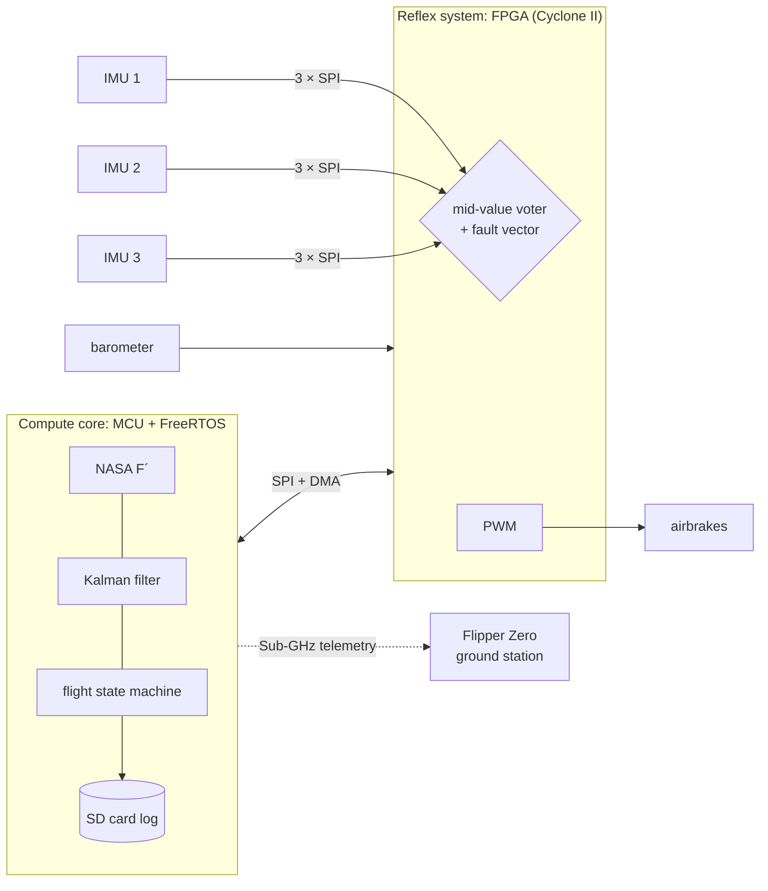
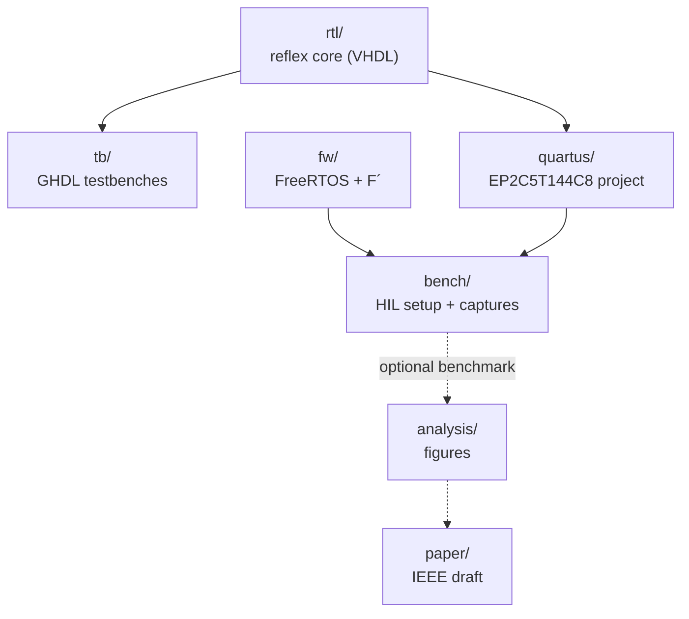
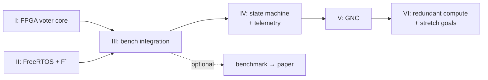

# EAGLE Rocket Flight Controller

> **E**mbedded **A**erospace **G**uidance & **L**ogic **E**ngine: an architectural design study for a hybrid MCU/FPGA amateur-rocket flight controller with triple-redundant sensors.

## Overview

EAGLE splits a flight computer the way real avionics do. A microcontroller running FreeRTOS and NASA F´ (**the brain**) handles flight logic, estimation and logging. A Cyclone II FPGA (**the reflex system**) reads three IMUs on a fixed schedule and votes on them in hardware, so one faulty sensor is outvoted. This is a design and research backlog: no flight software or VHDL exists yet.

## Architecture

## Design Targets

| Target | Why |
|---|---|
| **TMR sensor voting** in VHDL | 3 IMUs sampled on the same clock edge; the median wins, and a channel that drifts or goes silent is flagged |
| **SPI** MCU ↔ FPGA link | Every MCU has it, DMA makes the read cheap, and the FPGA already speaks SPI to the sensors |
| **MISRA C++:2023 + Power of 10** | For my own code (F´ itself is a documented deviation); no dynamic memory after initialization |
| **F´ on FreeRTOS** | NASA's flight framework, cross-compiled for the MCU |

**Scope:** the sensors are redundant, the computer is not yet. The MCU and the FPGA are single points of failure until Act VI (three MCUs, voted 2-out-of-3 by the FPGA).

## Repository

The bench for Acts I–III. Folders and READMEs, no code yet; each README says what goes there.

| Folder | What goes there |
|---|---|
| [`rtl/`](rtl/) | The VHDL core: SPI masters, mid-value voter, fault detector, SPI-slave link to the MCU, top level |
| [`tb/`](tb/) | Self-checking GHDL testbenches and their waveforms |
| [`quartus/`](quartus/) | The Quartus 13.0sp1 project and timing constraints |
| [`fw/`](fw/) | MCU firmware: FreeRTOS + F´, plus the MCU-only baseline for the benchmark |
| [`bench/`](bench/) | Wiring and capture procedure |
| [`analysis/`](analysis/) | Benchmark logs → jitter, latency, CPU-load and fault-latency plots |
| [`paper/`](paper/) | The benchmark paper, if the results hold up |

## Roadmap

Acts I and II run in parallel; Act III joins them on the bench. Checklist: [`EAGLE_Checklist.md`](EAGLE_Checklist.md). The benchmark is a side experiment, not a gate: [`RESEARCH_PAPER_PLAN.md`](RESEARCH_PAPER_PLAN.md).

---
*powered by logic, coffee, and many sleepless nights*
