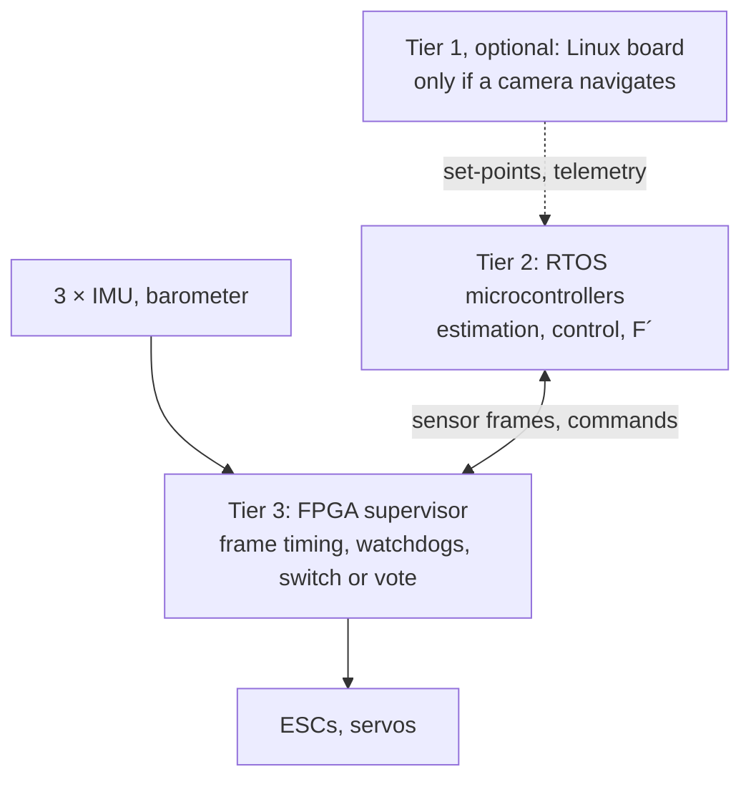

# EAGLE

> **E**mbedded **A**erospace **G**uidance & **L**ogic **E**ngine: a Phase A architecture study, written as Architecture Decision Records, for a fault-tolerant flight computer built from a Cyclone II FPGA (EP2C5T144C8), RTOS microcontrollers and, if a camera earns it, a Linux board.

## Overview

EAGLE works out, before anything is built, how a small flight computer keeps flying through its own faults. Six decision records, taken in dependency order, cover the vehicle, the fault-tolerance pattern, the hardware/software split, the inter-chip interfaces, the flight software stack, and the HDL and verification flow; each one lists the options, the constraints, the numbers with their sources and the trade-offs it accepts. The reference design is NASA's Ingenuity helicopter: Linux and F´ on a Snapdragon, two lockstep TMS570 microcontrollers as primary and hot spare, and a flash FPGA that switches between them. There is no hardware and no code; ADR-01 and ADR-02 are drafted and waiting on the owner's decisions, and ADR-03 to ADR-06 are scoped.

## Option space

Nothing in this picture is decided. The dotted tier exists only if [ADR-01](docs/adr/ADR-01-mission-profile.md) brings in a navigation camera. The FPGA is the one element every candidate pattern trusts, so [ADR-02](docs/adr/ADR-02-fault-tolerance.md) keeps it to timing, watchdogs and switching, and [ADR-03](docs/adr/ADR-03-partitioning.md) has to answer for it being SRAM-based: after a configuration upset the EP2C5 needs 47 to 61 ms to reconfigure, several times the delay margin ADR-01 assumes for a small multirotor.

## Fault-tolerance patterns under study

| Pattern | Channels | Catches | Misses | Flown on |
|---|---|---|---|---|
| P1 pair-and-spare | 2 lockstep MCUs, one active, one hot spare; the FPGA switches and power-cycles | crashes, hangs, link errors, silent errors inside a CPU core | silent errors outside the lockstep core; bugs common to both channels | Ingenuity |
| P2 2-out-of-3 vote | 3 MCUs on one broadcast frame; the FPGA votes | any single wrong output | common bugs; the voter itself | triple strings fly on Dragon and Falcon 9; how their outputs are combined is not public |
| P3 Simplex | a complex controller, a simple verified one, and a switch between them | design faults in the complex controller | hardware faults, unless P1 or P2 sits underneath | Sha, 2001 |
| P4 asymmetric pair | 2 ordinary MCUs, active and monitor | crashes, hangs; it sees a disagreement | which channel is wrong | – |

ADR-02 recommends P1 for the multirotor profile that ADR-01 recommends. Both are Proposed.

## Decision records

| ADR | Decides | Status | Depends on |
|---|---|---|---|
| [ADR-00](docs/adr/ADR-00-process.md) | How decisions are recorded, ordered and accepted | Proposed | – |
| [ADR-01](docs/adr/ADR-01-mission-profile.md) | Vehicle, validation path, feature scope | Proposed | – |
| [ADR-02](docs/adr/ADR-02-fault-tolerance.md) | Fault model, fault-tolerance pattern, degradation and recovery | Proposed | ADR-01 |
| [ADR-03](docs/adr/ADR-03-partitioning.md) | Tiers, function map, FPGA budget, microcontroller | Scoped | ADR-01, ADR-02 |
| [ADR-04](docs/adr/ADR-04-interchip-icd.md) | Inter-chip links, frames, out-of-band pins (the ICD) | Scoped | ADR-02, ADR-03 |
| [ADR-05](docs/adr/ADR-05-flight-software.md) | F´ deployment, RTOS, MISRA C++:2023 and Power of 10 boundary | Scoped | ADR-02, ADR-03 |
| [ADR-06](docs/adr/ADR-06-hdl-verification.md) | HDL, simulation, formal checks, SITL | Scoped | ADR-03, ADR-04, ADR-05 |

Scoped means the questions, options and known numbers are written; Proposed means a recommendation waits on the owner; only the owner accepts.

## Reading list

| Source | Why |
|---|---|
| J. Balaram et al., "Mars Helicopter Technology Demonstrator," AIAA 2018, [DOI 10.2514/6.2018-0023](https://doi.org/10.2514/6.2018-0023) | Ingenuity's avionics: Snapdragon 801, two lockstep TMS570LC43x, the ProASIC3L FPGA |
| H. F. Grip et al., "Guidance and Control for a Mars Helicopter," AIAA 2018, [DOI 10.2514/6.2018-1849](https://doi.org/10.2514/6.2018-1849) | The 500 Hz loop, its delay budget, crossover frequencies and margins |
| R. Bocchino, T. Canham et al., "F Prime: An Open-Source Framework for Small-Scale Flight Software Systems," SmallSat 2018, [paper](https://digitalcommons.usu.edu/smallsat/2018/all2018/328); T. Canham in [IEEE Spectrum, 2021](https://spectrum.ieee.org/automaton/aerospace/robotic-exploration/nasa-designed-perseverance-helicopter-rover-fly-autonomously-mars) | F´, and how it flew on Ingenuity |
| G. J. Holzmann, "The Power of 10: Rules for Developing Safety-Critical Code," IEEE Computer 39(6), 2006, [DOI 10.1109/MC.2006.212](https://doi.org/10.1109/MC.2006.212) | The coding rules for the flight-critical C++ |
| L. Sha, "Using Simplicity to Control Complexity," IEEE Software 18(4), 2001, [DOI 10.1109/MS.2001.936213](https://doi.org/10.1109/MS.2001.936213) | The Simplex architecture |
| [F´ documentation](https://fprime.jpl.nasa.gov/latest/docs/user-manual/) | Components, ports, rate groups, supported platforms |

Every ADR ends with its own source list.

## Documents

| Doc | What's in it |
|---|---|
| [docs/adr/](docs/adr/README.md) | The decision records, ADR-00 to ADR-06 |
| [EAGLE_Checklist.md](EAGLE_Checklist.md) | Phase A checklist: decisions, evidence, and where each old Act went |
| [archive/](archive/README.md) | The plan before Phase A: the 6-Act checklist, the benchmark-paper plan, the Phase 1 folder layout |

---
*powered by logic, coffee, and many sleepless nights*
