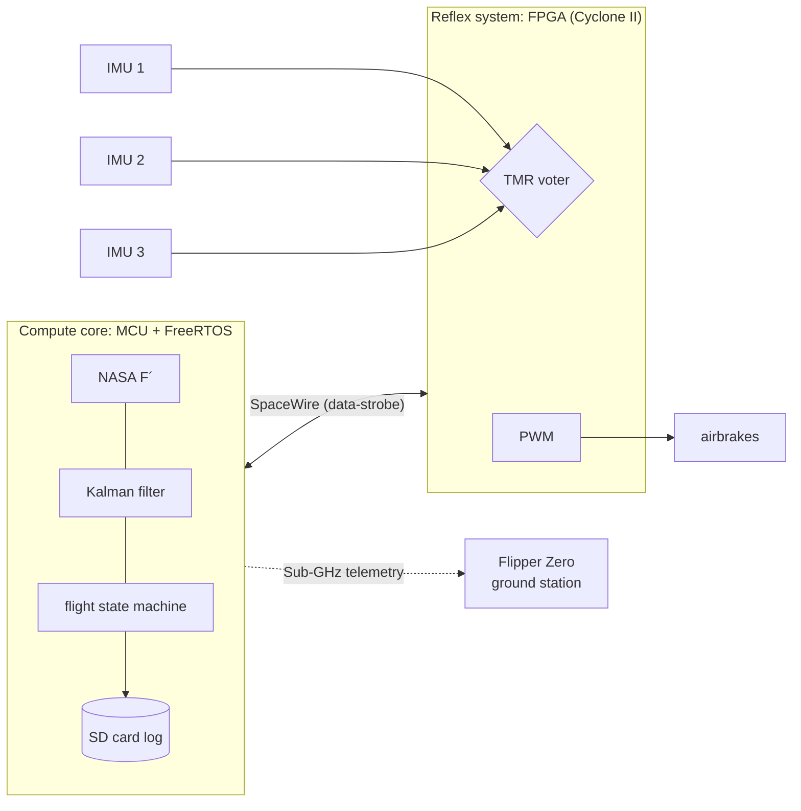
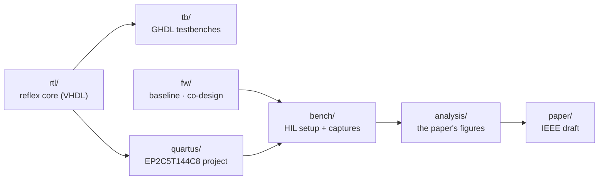
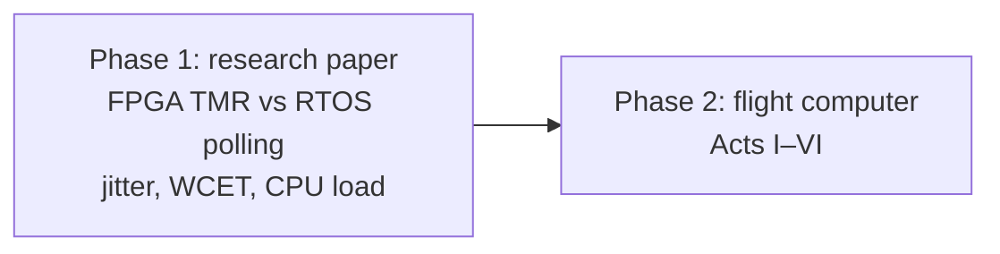

# EAGLE Rocket Flight Controller

> **E**mbedded **A**erospace **G**uidance & **L**ogic **E**ngine: an architectural design study for a hybrid MCU/FPGA amateur-rocket flight controller.

## Overview

EAGLE splits a flight computer the way real avionics do. An RTOS microcontroller (**the brain**) runs NASA F´, state management and flight math. A Cyclone II FPGA (**the reflex system**) talks to the sensors and servos with deterministic, cycle-exact timing. This is a design and research backlog: no flight software or VHDL exists yet.

## Architecture

## Design Targets

| Target | Why |
|---|---|
| **TMR sensor voting** in VHDL | 3 IMUs polled in parallel; a failed sensor is outvoted in hardware |
| **SpaceWire** MCU ↔ FPGA link | The ESA standard for bridging compute and I/O |
| **MISRA C++:2008 + Power of 10** | No dynamic memory; the rules flight code is written under |
| **F´ on FreeRTOS** | NASA's flight framework, cross-compiled to bare metal |

## Repository

Phase 1 only: the paper's bench. Folders and READMEs, no code yet; each README says what the plan puts there.

| Folder | What goes there |
|---|---|
| [`rtl/`](rtl/) | The VHDL pipeline: SPI masters, TMR voter, fault detector, telemetry TX, top level |
| [`tb/`](tb/) | Self-checking GHDL testbenches and their waveforms |
| [`quartus/`](quartus/) | The Quartus 13.0sp1 project and timing constraints |
| [`fw/`](fw/) | Baseline and co-design FreeRTOS firmware |
| [`bench/`](bench/) | Wiring and capture procedure |
| [`analysis/`](analysis/) | Logs → jitter, WCET, CPU-load and fault-latency plots |
| [`paper/`](paper/) | The Phase 1 paper |

## Roadmap

1. **Phase 1 (Act 0, in progress):** benchmark the FPGA reflex core against RTOS software polling. Target venue IEEE DASC / ESA PAC. Plan: [`RESEARCH_PAPER_PLAN.md`](RESEARCH_PAPER_PLAN.md).
2. **Phase 2 (Acts I–VI):** grow the proven core into full sounding-rocket avionics: F´, Kalman estimation, flight state machine, airbrake PID. Checklist: [`EAGLE_Checklist.md`](EAGLE_Checklist.md).

---
*powered by logic, coffee, and many sleepless nights*
