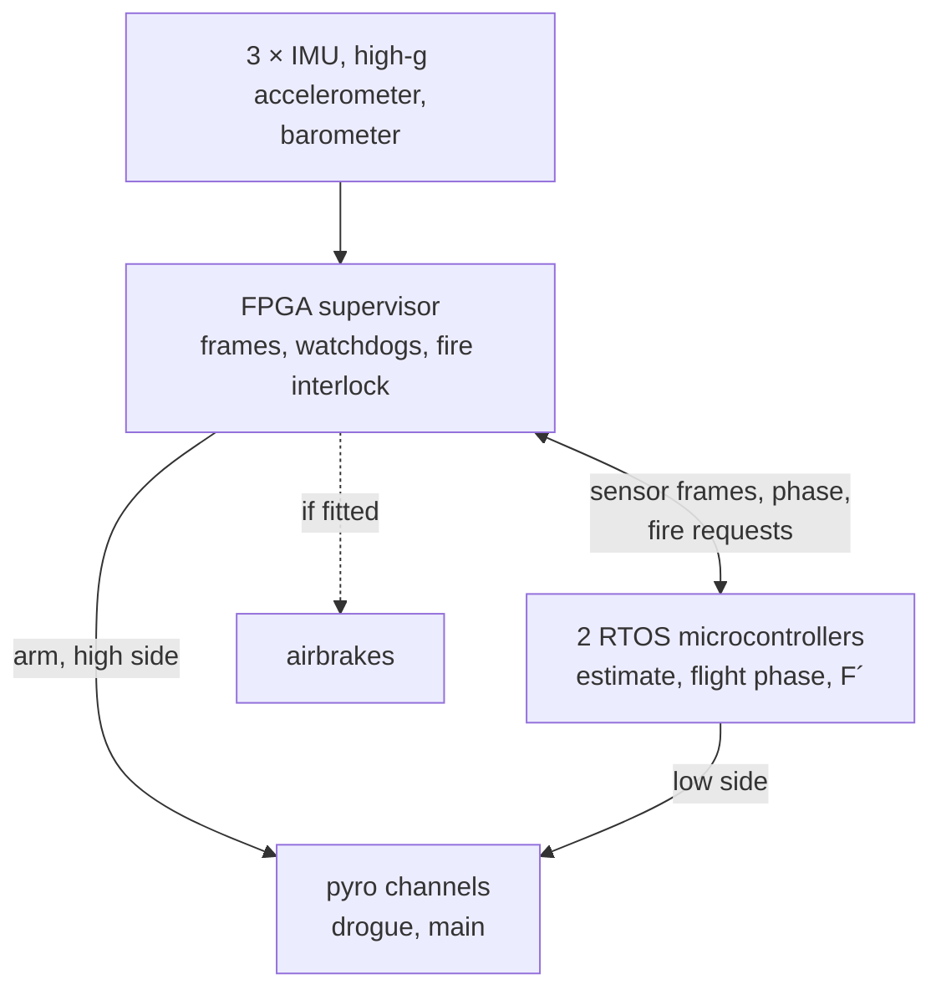
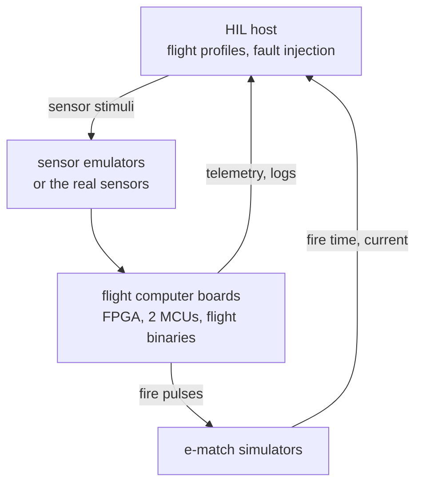

# EAGLE

> **E**mbedded **A**erospace **G**uidance & **L**ogic **E**ngine: a Phase A architecture study, written as Architecture Decision Records, for a fault-tolerant sounding-rocket flight computer built from a Cyclone II FPGA (EP2C5T144C8) and two RTOS microcontrollers, verified as a FlatSat.

## Overview

EAGLE works out, before anything is built, how a small rocket flight computer survives its own faults and still fires its recovery charges at the right time and never at the wrong one. Six decision records, taken in dependency order, cover the vehicle and test approach, the fault-tolerance pattern, the hardware/software split, the inter-chip interfaces, the flight software stack, and the HDL and verification flow; each lists the options, the constraints, the numbers with their sources and the trade-offs it accepts. The rocket is stable on its fins, so a flight shows almost nothing about failover: the flight computer is built and verified as a FlatSat, its boards laid out on a bench and driven by a hardware-in-the-loop rig, and that is where every failover path is measured. There is no hardware and no code; ADR-01 is accepted in part (rocket, FlatSat, no camera), ADR-02 is drafted and waits on the owner, and ADR-03 to ADR-06 are scoped.

## Option space

Two tiers are settled: with no camera there is nothing for a Linux board to do. Everything else is ADR-02's proposal. The microcontrollers decide *when* to fire, from the filtered estimate; the FPGA decides *whether*, from a few checks on raw sensor data (liftoff latched, time since liftoff, no thrust, pressure rising). A charge fires only when both sides close, so no single fault fires it early, and an independent backup altimeter with its own charges covers the FPGA's high side. The FPGA is SRAM-based: after a configuration upset it needs 47 to 61 ms to reconfigure, which fits every flight-phase budget below except the 8 ms boost estimate, and ADR-02 covers that with barometer-confirmed apogee.

## Flight phases

What a fault may cost depends on the phase. From [ADR-01](docs/adr/ADR-01-mission-profile.md) §3, derived for an assumed 10 g boost, a drogue that tolerates 10 m/s at deployment and a main at 200 m:

| Phase | Pyro semantics | Failover budget |
|---|---|---|
| pad | fail-safe; a channel fault holds the launch | unbounded |
| boost | fail-safe: no fire | 8 ms of inertial data, or barometer-confirmed apogee |
| coast | fail-safe: no fire; airbrakes retract on a fault | 0.5 s of inertial data |
| apogee | fail-operational: the drogue fires within ±1.0 s | 100 ms for the fire path |
| drogue descent | fail-operational at the main altitude | 4 s for the main fire path |
| main, landed | fail-safe: no further fire | unbounded |

## The FlatSat

The FlatSat runs the flight binaries unchanged against RocketPy or OpenRocket profiles, after SITL and an emulated FlatSat in software ([ADR-06](docs/adr/ADR-06-hdl-verification.md)). Showing a failover path works with 0.99 probability at 95% confidence takes 299 consecutive clean trials (ADR-01 §4); about eight paths at one trial per 30 s make roughly 20 hours of unattended FlatSat time.

## Fault-tolerance patterns under study

| Pattern | Channels | On a rocket | Left to the interlock, the backup altimeter or verification | Flown on |
|---|---|---|---|---|
| P1 pair-and-spare (proposed) | 2 lockstep MCUs on the same frames; the FPGA selects and power-cycles | the estimate survives any single channel fault in every phase; a core error is pinned to its channel in hardware | silent errors outside the lockstep core; bugs common to both channels | Ingenuity |
| P2 2-out-of-3 vote | 3 MCUs; a charge fires on two matching requests | outvotes any single wrong request | common bugs; the voter itself | triple strings fly on Dragon and Falcon 9; how their outputs are combined is not public |
| P3 Simplex | a complex controller bounded by a simple verified one | on a rocket it shrinks to the fire interlock, on top of P1, P2 or P4 | hardware faults below it | Sha, 2001 |
| P4 asymmetric pair (fallback) | 2 ordinary MCUs, active and monitor | either channel's request fires once the interlock agrees, so a missed fire is covered | which channel is wrong after a silent error | – |

## Decision records

| ADR | Decides | Status | Depends on |
|---|---|---|---|
| [ADR-00](docs/adr/ADR-00-process.md) | How decisions are recorded, ordered and accepted | Proposed | – |
| [ADR-01](docs/adr/ADR-01-mission-profile.md) | Vehicle, test approach, flight phases, sensors, actuators | Accepted in part: rocket, FlatSat, no camera; scope items Proposed | – |
| [ADR-02](docs/adr/ADR-02-fault-tolerance.md) | Fault model, pattern, who may fire, degradation and recovery | Proposed | ADR-01 |
| [ADR-03](docs/adr/ADR-03-partitioning.md) | Function map, FPGA budget, whether the EP2C5 flies, microcontroller | Scoped | ADR-01, ADR-02 |
| [ADR-04](docs/adr/ADR-04-interchip-icd.md) | Inter-chip links, frame period, frames, supervisor and pyro lines (the ICD) | Scoped | ADR-01, ADR-02, ADR-03 |
| [ADR-05](docs/adr/ADR-05-flight-software.md) | F´ deployment, RTOS, phase detection, ground commands, MISRA C++:2023 and Power of 10 boundary | Scoped | ADR-01 to ADR-04 |
| [ADR-06](docs/adr/ADR-06-hdl-verification.md) | HDL, simulation, formal checks, SITL, the FlatSat | Scoped | ADR-01 to ADR-05 |

Scoped means the questions, options and known numbers are written; Proposed means a recommendation waits on the owner; only the owner accepts.

## Reading list

| Source | Why |
|---|---|
| J. Balaram et al., "Mars Helicopter Technology Demonstrator," AIAA 2018, [DOI 10.2514/6.2018-0023](https://doi.org/10.2514/6.2018-0023) | Ingenuity's fault management: two lockstep TMS570LC43x as primary and hot spare, a ProASIC3L FPGA that switches and power-cycles them |
| NASA Engineering and Safety Center, [Technical Bulletin 23-01](https://ntrs.nasa.gov/api/citations/20230001889/downloads/TB_23-01_Pyro%20Best%20Practices_031523.pdf), 2023 | Pyro firing circuits: staged arming, separate high-side and low-side inhibits, inhibit monitors |
| Altus Metrum, [AltOS documentation](https://altusmetrum.org/AltOS/doc/altusmetrum.html) | A flown single-string rocket flight computer (TeleMega): sensors, pyro channels, apogee detection |
| M. Cols Margenet, H. Schaub, S. Piggott, "Avionics Hardware Modeling and Embedded Flight Software Testing in an Emulated Flat-Sat," AAS 20-103, 2020, [paper](https://hanspeterschaub.info/Papers/ColsMargenet2020.pdf) | What an emulated FlatSat can and cannot replace |
| R. Bocchino, T. Canham et al., "F Prime: An Open-Source Framework for Small-Scale Flight Software Systems," SmallSat 2018, [paper](https://digitalcommons.usu.edu/smallsat/2018/all2018/328) | F´ |
| G. J. Holzmann, "The Power of 10: Rules for Developing Safety-Critical Code," IEEE Computer 39(6), 2006, [DOI 10.1109/MC.2006.212](https://doi.org/10.1109/MC.2006.212) | The coding rules for the flight-critical C++ |
| L. Sha, "Using Simplicity to Control Complexity," IEEE Software 18(4), 2001, [DOI 10.1109/MS.2001.936213](https://doi.org/10.1109/MS.2001.936213) | The Simplex architecture, the idea behind the fire interlock |
| [F´ documentation](https://fprime.jpl.nasa.gov/latest/docs/user-manual/) | Components, ports, rate groups, supported platforms |

Every ADR ends with its own source list.

## Documents

| Doc | What's in it |
|---|---|
| [docs/adr/](docs/adr/README.md) | The decision records, ADR-00 to ADR-06 |
| [EAGLE_Checklist.md](EAGLE_Checklist.md) | Phase A checklist: decisions, evidence, and where each old Act went |
| [archive/](archive/README.md) | The plan before Phase A: the 6-Act checklist, the benchmark-paper plan, the Phase 1 folder layout |

---
*powered by logic, coffee, and many sleepless nights*
