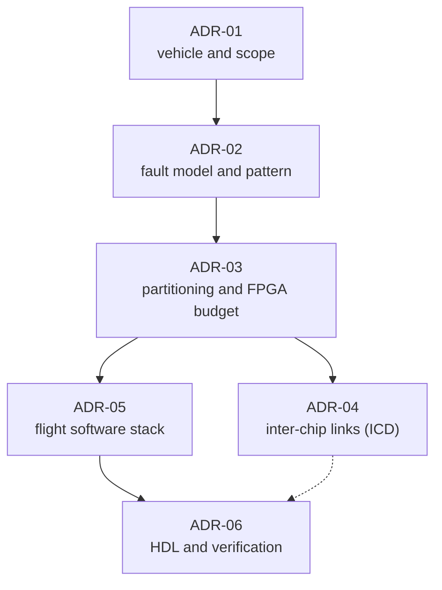

# ADR-00: How decisions are recorded

← [ADR index](../../README.md#decision-records)

| | |
|---|---|
| **Status** | Proposed |
| **Date** | 2026-11-22 |
| **Depends on** | nothing |
| **Decides** | the format, order and status rules every other ADR follows |

## Context

EAGLE is in Phase A: concept exploration and trade studies, with no hardware and no code. Every major
choice for the flight computer is written as an Architecture Decision Record (ADR) before anything is
built, so that the reasoning can be checked, argued with and reversed later without archaeology. The
decisions depend on each other (the vehicle sets the failover budget, the failover budget picks the
redundancy pattern, the pattern sizes the FPGA), so they are taken top-down in a fixed order.

## Status vocabulary

| Status | Meaning | Who sets it |
|---|---|---|
| **Scoped** | Context, questions, options, known constraints and the evidence that would settle it are written. No recommendation yet. | author |
| **Proposed** | A recommendation with its analysis is written and waits on the owner. Ends with "Decision needed from owner". | author |
| **Accepted** | The owner has decided. The decision, the date and any changes to the recommendation go into the History table. | owner only |
| **Superseded** | A later ADR replaces it. Both link to each other; the old text stays as it was. | owner |

Only the owner moves an ADR to Accepted. An ADR is never edited into a different decision after it is
Accepted: a changed mind is a new ADR that supersedes it.

## Order and dependencies



An ADR can be drafted while its upstream ADRs are still Proposed, but it cannot be Accepted before
them. When an Accepted upstream decision changes, every downstream ADR it feeds goes back to Proposed
with a History line saying why.

## Rules for the content

- **Numbers carry their origin.** Each number is cited (source in the ADR's Sources list), derived
  (the math is shown), measured (the measurement is described), or labelled as an *assumption* or a
  *target*. An estimate that has not been synthesized or measured says so.
- **No implementation in Phase A.** No VHDL, C++, FPP, build files or stubs. A short snippet inside an
  ADR is allowed only when a trade-off cannot be explained without it; prose, tables and math come first.
- **Options before recommendations.** Every option the brief or the benchmarks raise gets a row, including
  the ones that lose, with the reason they lose.
- **What would change it.** Each ADR names the evidence that would overturn it, so a later measurement
  has somewhere to land.
- **Open questions are listed.** A Proposed ADR ends with the exact questions the owner has
  to answer.

## Template

Copy this for a new ADR. Delete sections that do not apply to a Scoped ADR (Recommendation, Consequences).

```markdown
# ADR-NN: <the decision, in a few words>

← [ADR index](../../README.md#decision-records)

| | |
|---|---|
| **Status** | Scoped / Proposed / Accepted / Superseded by ADR-MM |
| **Date** | <date written> |
| **Depends on** | ADR-.. |
| **Decides** | <one line> |

## Context
<Why the decision is needed now, and what upstream ADRs already fixed.>

## Drivers and constraints
<Requirements, hard limits, numbers with their origin.>

## Options
<One row or subsection per option, including the losing ones.>

## Analysis
<Comparison tables, derivations, failure modes.>

## Recommendation
<Proposed only: what the author recommends and why.>

## Consequences
<The trade-offs that come with the recommendation, stated as accepted costs.>

## What would change this
<Evidence that would reverse the recommendation.>

## Decision needed from owner
<Numbered questions, each answerable in a sentence.>

## Sources
<Numbered list: author, title, venue, year, URL or DOI.>

## History
| Date | Change |
|---|---|
| <date> | Drafted; <status> |
```

## Decision needed from owner

1. Is the four-state vocabulary (Scoped, Proposed, Accepted, Superseded) right, or should Scoped fold
   into Proposed?
2. Should an Accepted ADR record who decided (always the owner here), or only the date?

## History

| Date | Change |
|---|---|
| 2026-11-22 | Drafted; Proposed |
