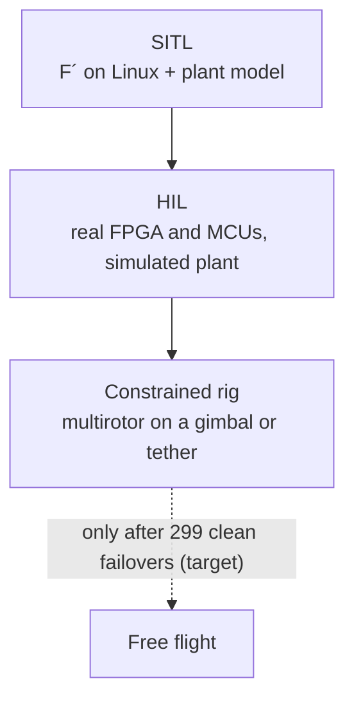

# ADR-01: Mission profile, target vehicle and feature scope

← [ADR index](../../README.md#decision-records)

| | |
|---|---|
| **Status** | Proposed |
| **Date** | 2026-11-22 |
| **Depends on** | nothing (root decision) |
| **Decides** | which vehicle the flight computer is designed for, how it is validated, and which features are in scope |

## Context

The fault-tolerance architecture is derived from the vehicle, so the vehicle comes first. Four of its
properties fix most of what follows:

1. **Stability with the actuators frozen or off.** An unstable plant makes the computer
   *fail-operational*: it has to keep producing correct commands through a fault. A stable plant allows
   *fail-safe*: stop, or do nothing, and the vehicle survives.
2. **The inner-loop rate**, which is the frame period that every link, voter and watchdog in ADR-02 to
   ADR-04 is sized against.
3. **The failover budget**: how long commands may be wrong, frozen or missing before the vehicle is lost.
4. **How many fault-injection trials the vehicle allows**, which decides whether a failover claim can be
   demonstrated at all.

The plan before this study ([`archive/EAGLE_Checklist-v1.md`](../../archive/EAGLE_Checklist-v1.md))
assumed an amateur rocket with airbrakes. This ADR reopens that choice, because the analysis below finds
the rocket the weakest of the candidates at exercising a fault-tolerant computer.

## Candidates

| | A. Small multirotor | B. Helicopter (Ingenuity class) | C. High-power sounding rocket | D. Ground rover |
|---|---|---|---|---|
| **Plant with actuators frozen** | unstable in attitude | unstable; on the Mars Helicopter the flapping dynamics remove roll and pitch damping [2] | stable in boost and coast while the centre of pressure is behind the centre of gravity [6]; recovery needs pyro events | stable: it stops |
| **Inner loop, reference** | 400 Hz, ArduCopter's normal main-loop rate; rate loops up to 4 kHz with its fast-rate thread [5] | 500 Hz GNC loop triggered by the IMU on the tethered demonstrator [2]; 500 Hz guidance loops in flight [3] | none needed for stability; an airbrake loop rate is a free choice | tens of Hz for vehicle-level control (*assumption*) |
| **Failover budget** | 6 to 12 ms for an assumed small-quad rate loop (§1) | 64 ms delay margin on the demonstrator's attitude loop (§1) | seconds in coast, about 1 s at apogee (§3), zero for an early pyro fire | unbounded for safety |
| **Behaviour required on a computer fault** | fail-operational | fail-operational | fail-operational for "fire at apogee", fail-safe for "never fire early" | fail-safe |
| **Fault-injection trials** | hundreds per day on a gimbal or tether rig | few (swashplate mechanics, cost) | one flight burns a motor and needs a launch site; motors and ejection charges are regulated (rules vary by country) | thousands per day |
| **Is a camera useful for flight?** | only for navigation without GNSS (optical flow, VIO), as on Ingenuity [1][3] | same | no; video is payload | for autonomy, never for stability |
| **What it exercises in a fault-tolerant computer** | all of it, under a deadline | all of it, under a deadline | the pyro inhibit chain; continuous control only if airbrakes fly | detection and switching, never under a deadline |

## Analysis

### 1. Failover budget from the delay margin

A loop with gain crossover ω_c and phase margin φ_m goes unstable when an added pure delay τ uses up the
margin. The delay e^(−sτ) contributes −ω_c·τ of phase at crossover, so

```text
τ_max = φ_m / ω_c          (φ_m in radians, ω_c = 2π·f_c)
```

A failover in which the FPGA holds the last good command looks to the loop like a delay as long as the
hold. One hold is a transient, while τ_max bounds a sustained delay, so τ_max is only a ceiling; the
allowance has to be a fraction of it.

| Loop | f_c | φ_m | τ_max | Origin |
|---|---|---|---|---|
| Mars Helicopter demonstrator, roll/pitch (inner) | 2.6 Hz | 60° | 64 ms | f_c, φ_m from [2]; τ derived |
| Mars Helicopter demonstrator, yaw | 1.9 Hz | 58° | 85 ms | [2]; derived |
| Mars Helicopter demonstrator, heave | 1.2 Hz | 60° | 139 ms | [2]; derived |
| Mars Helicopter demonstrator, translation (outer) | 0.3 Hz | 56° | 519 ms | [2]; derived |
| Small quadcopter rate loop | 10 Hz | 45° | 12.5 ms | *assumption*: replace with the airframe's identified model |
| Small quadcopter rate loop | 20 Hz | 45° | 6.3 ms | *assumption* |

The Mars Helicopter margins already pay for its known delays: 1 ms for the half-sample hold of the
500 Hz loop, 4 ms for communication, GNC execution and the asynchronous servos, 2.9 ms of gyro FIR lag
and 5.8 ms of accelerometer FIR lag [2]. That list is the template for EAGLE's own budget: the sample
hold, the FPGA hop, the MCU computation and any failover hold all come out of the same φ_m. Only the
inner loops matter for failover; the outer loops have an order of magnitude more room.

### 2. Wrong, missing and frozen commands

A failover reaches the actuators in one of three ways, worst first:

| What the motors see | Effect on a multirotor | Who decides |
|---|---|---|
| **Wrong**: a faulty channel's command gets through | attitude error θ = ½·α·t², with α the angular acceleration the bad command produces, up to the vehicle's full control authority | the voter or switch (ADR-02) |
| **Missing**: frames stop | whatever the ESC firmware does on signal loss; if it stops the motor, that is the second-worst outcome for a multirotor | the ESC; measure it for the chosen ESC |
| **Frozen**: the FPGA repeats the last good command | the vehicle flies open loop for the hold; under a disturbance α_d, θ = ½·α_d·t² | the FPGA's hold-last logic |

How long a single hold may last before the attitude error passes θ_max = 5° (0.087 rad):

| α (rad/s²) | t = √(2·θ_max/α) | Case |
|---|---|---|
| 50 | 59 ms | frozen command under a gust (*assumed α*) |
| 200 | 30 ms | wrong command with high authority (*assumed α*) |

Both are larger than the delay ceilings of an assumed small quad (6 to 12 ms), so the delay margin is
the binding limit, and it argues for a **failover requirement of one control period**: no actuator
command older than one frame, 2 ms at 500 Hz and 2.5 ms at 400 Hz (*target*). That leaves a factor of 3
against the most demanding assumed loop and a factor of 32 against the Mars Helicopter's inner loop.

The same arithmetic applies to the FPGA itself. The EP2C5 is SRAM-based; recovering from a
configuration upset means reconfiguring it, which takes 47.1 ms typically and 61.2 ms at most in Active
Serial mode, and a power cycle adds a power-on reset of at least 100 ms [7]. During configuration every
user I/O is tri-stated with 10 to 50 kΩ weak pull-ups [7], so the actuators see "missing" for 47 to
61 ms plus the time the upset took to detect. On a multirotor that is 4 to 10 times the assumed
small-quad ceiling: an in-flight configuration
upset costs control. On the rocket outside its pyro windows, and on the rover, it is survivable. ADR-02
and ADR-03 have to answer for this.

### 3. Rocket recovery timing

Near apogee the vertical speed passes through zero and, with drag small at low speed, grows as
v ≈ g·Δt after it. A drogue fired Δt late opens at about 9.8 m/s for Δt = 1 s and 19.6 m/s for
Δt = 2 s; the parachute's drag, and roughly its opening load, scale with v², so the second case is four
times the first. The apogee window is on the order of a second, which every pattern in ADR-02 meets
with millisecond failover. The hard requirement points the other way: an early fire during boost is
catastrophic and has no tolerant side. That is an inhibit problem (independent arm and fire conditions,
a physical arm switch, both required to fire), solved by fail-safe design of the pyro chain; a hot spare
computer does little for it.

### 4. How many trials a failover claim needs

With zero failures allowed, showing a success probability R at confidence C takes

```text
n ≥ ln(1 − C) / ln(R)
R = 0.99,  C = 0.95  →  n ≥ 298.1  →  299 consecutive successes
R = 0.999, C = 0.95  →  n ≥ 2,994.2 →  2,995 consecutive successes
```

On a rig, one injected fault every 30 s gives 299 trials in about 2.5 hours. A rocket gets at most one
injection per flight, and nobody injects a fault into a live recovery chain on purpose, so its failover
can only be shown in hardware-in-the-loop; its flights prove nothing statistically.

### 5. Validation path



Each step keeps the unstable plant, real or simulated. A rover is a poor validation vehicle for an
aerial design: its safe state (stop) hides exactly the behaviour this architecture exists for, holding
control through a fault under a deadline. It is still a cheap bench for bringing up the links (ADR-04)
and the fault log.

### 6. Feature scope

| Feature | Proposed scope | Notes |
|---|---|---|
| IMUs | 3 × ICM-42688-P | Already chosen (the MPU-6050 of the old plan is I2C-only). SPI to 24 MHz, ODR up to 32 kHz, and an external clock input for sample synchronisation [8]. Three are needed only if ADR-02 requires flying through an IMU fault; Ingenuity carries two IMUs [1] and does not continue a flight after a sensor fails [3]. |
| Barometer | 1, part open | Altitude hold; apogee detection in the rocket profile |
| Magnetometer, GNSS | out for rig and indoor flight, in for outdoor flight | Owner decision 4 |
| Estimation | attitude and vertical channel at the loop rate | Position only with GNSS or vision |
| Motor actuators | 4 ESCs over DShot600 | Fixed 16-bit frame (11 throttle, 1 telemetry request, 4 CRC), 26.7 µs per frame [9]; a fixed frame with a CRC suits generation in the FPGA. PWM is the fallback. |
| Servos | rocket airbrakes or a camera gimbal only | 1 to 2 ms pulse about every 20 ms [10] |
| Pyro | rocket profile only | Two channels, independent arm and fire, physical arm switch |
| Ground commanding | F´ GDS over a serial radio | The old plan's CC1101 Sub-GHz link and Flipper Zero ground station remain an option |
| Fault logging | every detection, switch, reset and power cycle, with timestamp and frame sequence, to non-volatile storage; fault counters in the FPGA readable over the ICD | Medium (SD card or SPI flash) open |
| Camera | out of scope | See below |

**The camera.** A camera that only records is a self-contained module with no link to the flight
computer and needs no architecture. A camera that navigates brings a Linux board (Tier 1), seconds of
boot time (to be measured), a power budget, and a new failure class: on Ingenuity's sixth flight a
single lost navigation image left every later image with a wrong timestamp, and the vehicle rolled and
pitched more than 20° before landing [4]. That is worth the complexity only if the mission must fly
without GNSS. Without it, ADR-03 starts from two tiers.

## Recommendation

1. **Reference profile: a small multirotor (quadcopter)**, fail-operational, inner loop 400 to 500 Hz,
   failover requirement *no actuator command older than one control period* (2 to 2.5 ms, target).
2. **Keep the sounding rocket as a documented alternative profile** with its own requirement set (pyro
   inhibit chain, about 1 s apogee window); the multirotor drives the design.
3. **Validate through SITL, HIL and a constrained rig**, with no free flight before the rig has shown the
   failover 299 times in a row (target: 0.99 at 95% confidence).
4. **Feature scope as in §6**: no camera, two tiers as ADR-03's starting point.

The multirotor is the only candidate in which the fault-tolerant computer is needed every millisecond,
it matches the benchmark (Ingenuity: an unstable rotorcraft, 500 Hz, a hot spare), and it can be tested
hundreds of times a day on a rig. The rocket's critical function is a pyro inhibit chain, which wants
fail-safe hardware more than a voting computer. The rover never needs a failover at all.

### Requirements handed to ADR-02

| Id | Requirement | Origin |
|---|---|---|
| R1 | Keep flying through any single fault of one computing channel | §1, unstable plant |
| R2 | No actuator command older than one control period during a failover (*target*) | §1, §2 |
| R3 | A wrong command reaches the actuators for at most one frame (*target*) | §2 |
| R4 | The FPGA's own configuration upset is either survivable or recorded as an accepted risk | §2 |
| R5 | Every failover path can be injected on the rig at least 299 times | §4 |
| R6 | Every fault event is logged with timestamp and frame sequence | §6 |

## Consequences

- The airbrake and apogee-control work of the archived plan stops driving the design; it lives on in
  the alternative profile.
- A gimbal or tether rig has to be built; that mechanical work sits outside this study.
- The SRAM FPGA in the actuator path stops being a footnote: 61 ms of reconfiguration is a loss of
  control on the reference vehicle (R4).
- R2 rules out every pattern that needs a cold restart of the active channel before commands resume.

## What would change this

- No place to rig or fly a multirotor, but access to a rocketry club and launch site: the rocket profile
  becomes the driver, and ADR-02's weight moves to the pyro inhibit chain.
- An identified model of the real airframe with much more delay margin than assumed (a large, slow
  multirotor): R2 relaxes.
- A mission that must navigate without GNSS: the camera comes in, and with it Tier 1.

## Decision needed from owner

1. Reference vehicle: quadcopter (recommended), sounding rocket (the original plan), or both with one
   of them as the driver?
2. Is a gimbal or tether rig acceptable as the step before free flight, and is there somewhere to fly?
3. Camera out of scope (recommended), or GNSS-free navigation in scope, which brings Tier 1?
4. Rig and indoor flight only in Phase A, or outdoor flight with GNSS and a magnetometer?
5. ESC protocol: DShot600 (recommended for FPGA generation) or PWM?
6. Ground link: keep the CC1101 and Flipper Zero ground station, or another radio?
7. Three IMUs to fly through an IMU fault, or two and land on a sensor fault as Ingenuity does?
   (Coupled to ADR-02.)

## Sources

1. J. Balaram, T. Canham, C. Duncan, H. F. Grip, W. Johnson, J. Maki, A. Quon, R. Stern, D. Zhu,
   "Mars Helicopter Technology Demonstrator," AIAA Atmospheric Flight Mechanics Conference, 2018,
   DOI 10.2514/6.2018-0023.
   <https://rotorcraft.arc.nasa.gov/Publications/files/Balaram_AIAA2018_0023.pdf>
2. H. F. Grip, D. P. Scharf, C. Malpica, W. Johnson, M. Mandic, G. Singh, L. A. Young, "Guidance and
   Control for a Mars Helicopter," AIAA Guidance, Navigation, and Control Conference, 2018,
   DOI 10.2514/6.2018-1849, §IX (500 Hz loop, delay budget, crossover frequencies and margins).
   <https://rotorcraft.arc.nasa.gov/Publications/files/Grip_AIAA2018_1849.pdf>
3. E. Ackerman, interview with T. Canham (JPL), "How NASA Designed a Helicopter That Could Fly
   Autonomously on Mars," IEEE Spectrum, 2021 (500 Hz guidance loops, 30 Hz feature tracking, landing on
   a sensor fault).
   <https://spectrum.ieee.org/automaton/aerospace/robotic-exploration/nasa-designed-perseverance-helicopter-rover-fly-autonomously-mars>
4. H. F. Grip, "Surviving an In-Flight Anomaly: What Happened on Ingenuity's Sixth Flight," NASA, 27 May 2021.
   <https://science.nasa.gov/blog/surviving-an-in-flight-anomaly-what-happened-on-ingenuitys-sixth-flight/>
5. ArduPilot, "Aggressive Rate Loop Tuning" (rate controllers at the main-loop rate, 400 Hz given as the
   normal speed; fast-rate thread up to 4 kHz on H7 boards).
   <https://ardupilot.org/copter/docs/high-loop-rate-tuning.html>
6. NASA Glenn Research Center, Beginner's Guide to Aeronautics, "Rocket Stability."
   <https://www1.grc.nasa.gov/beginners-guide-to-aeronautics/rocket-stability/>
7. Altera, Cyclone II Device Handbook, Volume 1, February 2007: Chapter 4 (power-on reset, wake-up
   time), Table 5–3 (R_CONF 10/25/50 kΩ), Chapter 13 (AS configuration time for the EP2C5, 61.2 ms max,
   47.1 ms typical; Table 13–7, POR delay 100 ms minimum for non-"A" devices).
   <https://www.cs.columbia.edu/~sedwards/classes/2008/4840/cyc2_cii5v1.pdf>
8. TDK InvenSense, ICM-42688-P product brief PB-000072 rev. 1.0, 2020 (24 MHz SPI, 32 kHz ODR with
   external clock sync, 2 kB FIFO). <https://www.farnell.com/datasheets/3045877.pdf>
9. "DShot and Bidirectional DShot," brushlesswhoop.com (16-bit frame layout, DShot600 bit period
   1.67 µs, frame 26.72 µs, CRC). <https://brushlesswhoop.com/dshot-and-bidirectional-dshot/>
10. Pololu, "Servo control interface in detail" (1 to 2 ms pulses, about 20 ms period).
    <https://www.pololu.com/blog/17/servo-control-interface-in-detail>

## History

| Date | Change |
|---|---|
| 2026-11-22 | Drafted; Proposed |
