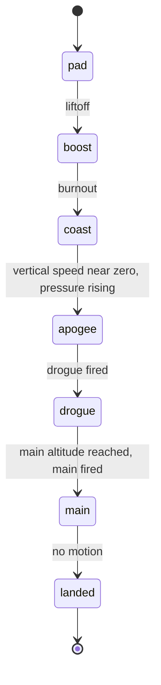
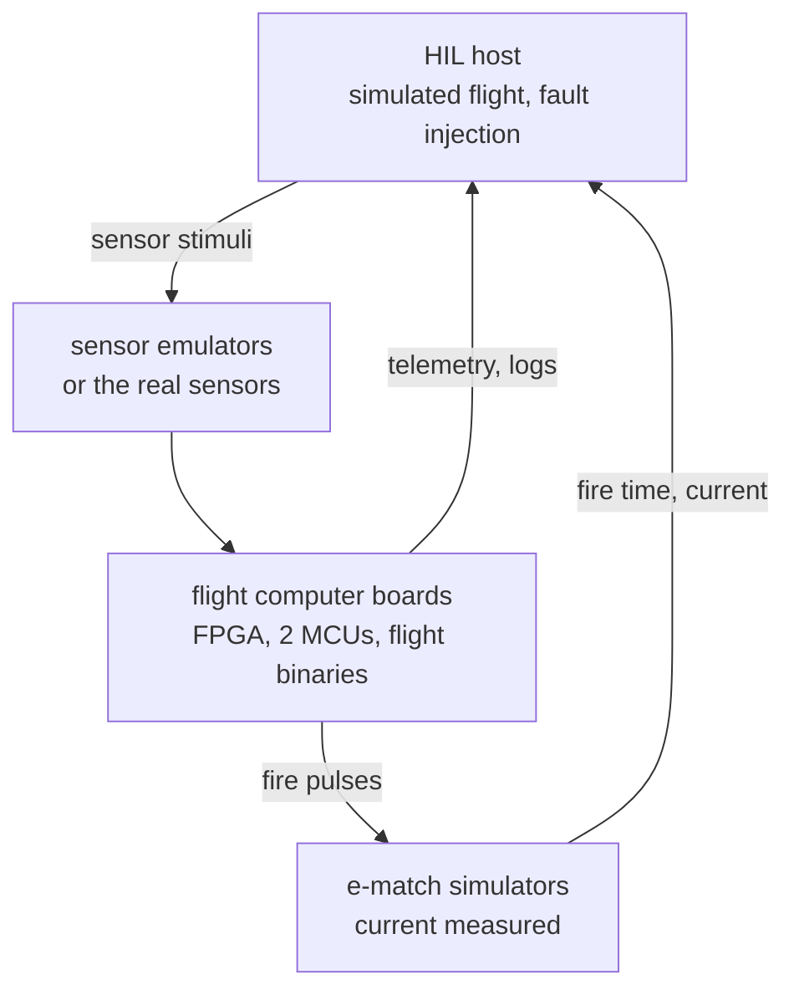

# ADR-01: Mission profile, target vehicle and test approach

← [ADR index](../../README.md#decision-records)

| | |
|---|---|
| **Status** | Accepted in part (owner, 2026-11-22): the vehicle, the FlatSat test approach and no camera. Proposed: the scope items listed under "Decision needed from owner" |
| **Date** | 2026-11-22 |
| **Depends on** | nothing (root decision) |
| **Decides** | the vehicle, how the flight computer is verified, the flight phases and what each phase demands, the sensors and the actuators |

## Decision (Accepted)

1. **Vehicle: a high-power sounding rocket**, stable on its fins (centre of pressure behind the
   centre of gravity [3]), with pyro-deployed recovery.
2. **Test approach: a FlatSat.** The flight computer is built and verified as a FlatSat: its boards laid
   out on a bench, wired as in flight, and driven by a hardware-in-the-loop rig. Software first and
   simulation first; the FlatSat measures, the flight demonstrates (§4, §8).
3. **No camera**, so two tiers: the FPGA and the microcontrollers. A video camera can still fly as a
   self-contained payload with no link to the flight computer.

The first draft of this ADR recommended a small multirotor; the owner chose the rocket. The two
arguments the draft made against the rocket are kept, as requirements: a stable airframe means failover
has to be measured on the FlatSat (§4), and the pyro chain with its apogee window is the hard problem
(§3, §5). The multirotor, the helicopter and the rover are the rejected alternatives (§9).

## Context

A rocket flight computer has a different job from an autopilot. Nothing has to be stabilised every
millisecond; the computer has to make a few discrete decisions (fire the drogue, fire the main) inside
their windows, and never make them at the wrong time. What a fault means therefore depends on the flight
phase: the same crash is harmless in coast and costly at apogee. This ADR fixes the phases, derives what
each one demands, and fixes the sensors, actuators and test approach that follow.

## 1. Flight phases



| Phase | Entered when (simple form) | The flight computer must |
|---|---|---|
| pad | arm switch closed on the rail | report health and continuity; a faulty channel is a no-go |
| boost | high-g acceleration above a threshold for a minimum time | integrate and log; keep every pyro inhibited |
| coast | acceleration drops below the burnout threshold | estimate apogee; run the airbrakes if fitted; keep pyros inhibited |
| apogee | vertical speed near zero and barometric pressure rising | fire the drogue inside the window |
| drogue | drogue fired | watch altitude; fire the main at the main altitude |
| main | main fired | log; no further pyro events |
| landed | no motion for a set time | make the pyros safe; keep the logs |

Thresholds and times are ADR-05's to set. Barometric pressure is unreliable near Mach 1: transonic
pressure errors are why some altimeters carry a "Mach delay" [13], while a filter that fuses the
accelerometer with the barometer makes that delay unnecessary [9]. Either way, apogee detection must not
trust raw pressure during boost.

## 2. Reference profile (assumptions)

No motor or airframe is chosen yet (owner decision 1). The derivations below use these values; each is an
*assumption* to be replaced when the vehicle exists.

| Quantity | Value | Basis |
|---|---|---|
| Boost acceleration a_b | 10 g (5 to 20 g) | set by the motor |
| Drag deceleration just after burnout a_d | 2.6 g | ½·ρ·v²·C_d·A / m with v = 250 m/s, ρ = 1.1 kg/m³, C_d = 0.5, a 98 mm airframe (A = 7.5 × 10⁻³ m²), m = 5 kg |
| Deployment speed the drogue tolerates at apogee, v_dep | 10 m/s | set by the drogue and its shock cord |
| Drogue descent rate v_d | 25 m/s | set by the drogue size |
| Main deployment altitude h_main | 200 m above ground | owner choice |
| Lowest altitude at which the main may still open, h_min | 100 m | owner choice |

## 3. Phase semantics and failover budgets

Two questions per phase: may a pyro fire (fail-safe: it must not; fail-operational: it must, inside a
window), and how long may the state estimate go without sensor data?

**a. Boost, state.** If sensor frames stop for Δt and the estimator holds the last acceleration, its
velocity error is at most Δa·Δt, where Δa is how far the true acceleration can move during the gap. The
worst gap straddles burnout: Δa = a_b + a_d = 12.6 g. A velocity error δv shifts the predicted apogee
time by δv/g. Allowing 0.1 s of apogee-time error (a tenth of the ±1 s window in c, *target*):

```text
δv = g · 0.1 s = 0.98 m/s
Δt_max = δv / Δa = 0.98 / (12.6 · 9.81) = 7.9 ms
```

An inertial gap longer than about 8 ms in boost therefore cannot be absorbed by dead reckoning. Either the
estimate survives it (a hot spare, ADR-02), or apogee is confirmed by the barometer, which needs no
integration.

**b. Coast, state.** After burnout the acceleration changes slowly: drag falls with v². With
dv/dt = −(g + a_d) = −35.7 m/s² just after burnout, da_d/dt = 2·(a_d/v)·dv/dt = −7.4 m/s³. Holding the last
acceleration, the error grows as ½·|da_d/dt|·Δt², so the same δv allows

```text
Δt_max = √(2 · 0.98 / 7.4) = 0.51 s
```

**c. Apogee window.** Near apogee the vertical speed grows as v ≈ g·|t − t_apogee| on either side (drag
is small at low speed). Firing within ±v_dep/g keeps the deployment speed under v_dep:
±10 / 9.81 = ±1.0 s. The fire path's failover gets a tenth of the half-window: **100 ms** (*target*).

**d. Drogue descent to the main.** A main fired Δt late opens at h_main − v_d·Δt. Staying above h_min
allows Δt ≤ (h_main − h_min)/v_d = (200 − 100)/25 = **4 s**. A main fired early (at apogee) means a long
drift under the main; that is a recovery problem, not a structural one.

| Phase | Pyro semantics | State semantics | Failover budget | Origin |
|---|---|---|---|---|
| pad | fail-safe: no fire; a channel fault is a no-go for launch | – | unbounded (the launch is held) | procedure |
| boost | fail-safe: no fire | fail-operational | 8 ms of inertial data, or barometer-confirmed apogee | a |
| coast | fail-safe: no fire; airbrakes, if fitted, retract on a fault | fail-operational | 0.5 s of inertial data | b |
| apogee | fail-operational: the drogue fires within ±1.0 s | needed for the decision | 100 ms for the fire path | c |
| drogue | fail-safe for the main above h_main; fail-operational at h_main | barometric altitude | 4 s for the main fire path | d |
| main, landed | fail-safe: no further fire | logging | unbounded | – |

The 8 ms boost figure is the tightest number in the study, and it constrains the estimate, not the
pyros: nothing fires in boost.

## 4. Requirement from the stable airframe: failover is measured on the FlatSat

The rocket flies the same way whether or not its computer survives a fault, so a flight says almost
nothing about failover. With zero failures allowed, showing a success probability R at confidence C takes

```text
n ≥ ln(1 − C) / ln(R)
R = 0.99,  C = 0.95  →  n ≥ 298.1  →  299 consecutive successes
R = 0.999, C = 0.95  →  n ≥ 2,994.2 →  2,995 consecutive successes
```

A flight gives at most one injected fault, and nobody injects a fault into a live recovery chain. So
every failover path is demonstrated on the FlatSat: **at least 299 consecutive clean failovers per path**
(*target*: 0.99 at 95% confidence), each injected at a chosen moment of a simulated flight, for example
200 ms before apogee. At one injection every 30 s, 299 trials take about 2.5 hours of FlatSat time.

## 5. Requirement from the pyro chain

- **Never fire early.** In boost and coast no single fault may fire a pyro channel (one-fault tolerance
  against inadvertent firing, *target*; NASA asks crewed systems for two [8]).
- **Fire inside the window.** No single fault of the computing channels may stop the drogue firing within
  ±1.0 s of apogee, or the main within 4 s of h_main (ADR-02). A fault in the firing hardware itself is
  covered by an independent backup altimeter with its own battery and charges, outside EAGLE.
- **Staged arming.** A physical arm switch closes on the pad and connects a separate pyro battery, as on
  TeleMega, which has its own pyro battery and switch [9]. The electronic arm stage closes later, in
  coast, following NASA's guidance to arm a firing circuit only when firing is imminent [8].
- **Who may fire.** The microcontrollers decide *when* (estimate and phase). The FPGA decides *whether*,
  from a few simple checks on raw sensor data (liftoff latched, minimum time since liftoff, no thrust on
  the high-g accelerometer, pressure rising for N frames), and it drives the high-side switch; the
  microcontrollers drive the low-side switch. Keeping the two sides in separate fault containment regions,
  with the state of every inhibit monitored, is NASA's practice [8]. ADR-02 analyses this chain and
  ADR-04 defines its pins.

## 6. Sensors

| Sensor | Proposed | Notes |
|---|---|---|
| IMUs | 3 × ICM-42688-P | the accelerometer's full scale is ±16 g [5], which a boost can exceed; the IMUs supply rates and attitude, the high-g part supplies boost acceleration. Three only if ADR-02 needs IMU fault tolerance |
| High-g accelerometer | 1 or 2 × ADXL375 | ±200 g, SPI or I²C [10]; TeleMega v4 to v6 fly the ADXL375 [9] |
| Barometer | 1 or 2, for example MS5611 | 10 to 1,200 mbar extended range, full accuracy from 450 to 1,100 mbar, SPI to 20 MHz [11]; TeleMega's MS5607 is rated to 30 km [9]. The target apogee picks the part |
| GNSS | optional, for recovery location | u-blox F9 and M10 datasheets give operational limits of 500 m/s, 4 g and 80,000 m for an airborne 4 g platform [12]: the receiver can drop out in boost. Never part of the fire decision |
| Magnetometer | optional | attitude reference |

## 7. Actuators and other features

| Feature | Proposed | Notes |
|---|---|---|
| Pyro channels | 2 (drogue, main), each with an arm stage, high-side and low-side switches, and continuity sensing | after NASA's notional firing circuit [8] |
| Airbrakes | optional (owner decision 4) | a servo, 1 to 2 ms pulses about every 20 ms [7]; coast only; on a fault they retract, never deploy asymmetrically |
| Backup deployment | an independent altimeter, own battery and charges | outside EAGLE; covers the FPGA's high-side switch as a single point |
| Ground commanding | F´ GDS over a serial radio | the archived plan's CC1101 link and Flipper Zero ground station are an option |
| Fault log | every detection, switch, reset, power cycle, arm and fire event, with timestamp and frame sequence | medium (SD card or SPI flash) open |
| Camera | none | owner decision |

## 8. The FlatSat

A FlatSat is spacecraft avionics laid out flat on a bench, where every part is reachable [16]; NASA
Goddard lists "Flat Sat Integration" among its integration-and-test services [17]. For EAGLE it is the
place where the flight computer is integrated and where its failover numbers are measured.



- **Contents:** the FPGA board, the microcontroller boards, the sensor boards, pyro channel boards
  firing into e-match simulators, the flight battery or a current-logging bench supply, and the flight
  harness. The HIL host replays or simulates flights and injects faults.
- **Flight profiles:** from RocketPy (6-degree-of-freedom trajectories, MIT licence [14]) or OpenRocket
  (GPL [15]).
- **Order:** SITL, then an emulated FlatSat (every board a software model), then the hardware FlatSat,
  then flight. An emulated FlatSat is useful early, but software simulation "does not replace hardware
  flat-sat tests" [18]. ADR-06 owns the details.
- **Same binaries:** the FlatSat runs the flight binaries unchanged, so what is tested is what flies, in
  the sense of the Aerospace Corporation's "test like you fly" process [19].
- **Statistics:** the 299 clean failovers per path of §4 are counted here.

## 9. Alternatives considered and rejected

| | Small multirotor | Helicopter (Ingenuity class) | Ground rover |
|---|---|---|---|
| Why it was considered | an unstable plant exercises fail-operational control in every frame | the benchmark itself | the cheapest to test |
| Numbers that came with it | rate controllers at ArduCopter's 400 Hz main loop [2]; delay margin φ_m/ω_c of 6 to 12 ms for an assumed 10 to 20 Hz, 45° rate loop; a failover target of one control period (2 to 2.5 ms); ESCs over DShot600, 26.7 µs per frame [6] | 500 Hz GNC loop; 64 ms delay margin on the demonstrator's attitude loop (2.6 Hz, 60° [1]) | vehicle loops of tens of Hz |
| Why it was rejected | the owner chose the rocket. It also needs a rig and a flying site, and the EP2C5's 47 to 61 ms reconfiguration [4] is 4 to 10 times its assumed margin: a loss of control | swashplate mechanics and cost | its safe state (stop) hides the behaviour the architecture exists for |

The rocket turns that last problem around: 47 to 61 ms fits inside every rocket budget of §3 except the
8 ms boost estimate, which barometer-confirmed apogee covers. ADR-02 works through it.

## Decision needed from owner

1. Target apogee and motor class. These set a_b, the Mach regime, the barometer and the GNSS limits, and
   replace the assumptions of §2.
2. Recovery: dual deploy (drogue and main, proposed) or a single deployment?
3. The drogue's tolerable deployment speed (10 m/s assumed, which sets the ±1 s window) and the main
   altitude (200 m assumed)?
4. Airbrakes in scope?
5. GNSS in scope, for recovery location?
6. An independent backup altimeter with its own charges (proposed)?
7. Sensor counts: three IMUs, one or two high-g accelerometers, one or two barometers?
8. Ground link: keep the CC1101 and Flipper Zero ground station, or another radio?

## Sources

1. H. F. Grip et al., "Guidance and Control for a Mars Helicopter," AIAA GNC Conference, 2018,
   DOI 10.2514/6.2018-1849, §IX. <https://rotorcraft.arc.nasa.gov/Publications/files/Grip_AIAA2018_1849.pdf>
2. ArduPilot, "Aggressive Rate Loop Tuning." <https://ardupilot.org/copter/docs/high-loop-rate-tuning.html>
3. NASA Glenn Research Center, Beginner's Guide to Aeronautics, "Rocket Stability" (the centre of pressure
   must lie behind the centre of gravity).
   <https://www1.grc.nasa.gov/beginners-guide-to-aeronautics/rocket-stability/>
4. Altera, Cyclone II Device Handbook, Volume 1, February 2007: Chapter 4 (power-on reset), Table 5–3
   (R_CONF), Chapter 13 (EP2C5 AS configuration, 61.2 ms max, 47.1 ms typical).
   <https://www.cs.columbia.edu/~sedwards/classes/2008/4840/cyc2_cii5v1.pdf>
5. TDK InvenSense, ICM-42688-P product brief PB-000072 (accelerometer full scale ±2/4/8/16 g, 24 MHz SPI,
   external clock input). <https://www.farnell.com/datasheets/3045877.pdf>
6. "DShot and Bidirectional DShot," brushlesswhoop.com. <https://brushlesswhoop.com/dshot-and-bidirectional-dshot/>
7. Pololu, "Servo control interface in detail." <https://www.pololu.com/blog/17/servo-control-interface-in-detail>
8. NASA Engineering and Safety Center, Technical Bulletin 23-01, "Including Key Design Features in
   Safety-Critical Pyrotechnic Firing Circuits," 15 March 2023 (two-fault tolerance for crewed systems,
   arm only when firing, inhibit monitors, separate fault containment regions).
   <https://ntrs.nasa.gov/api/citations/20230001889/downloads/TB_23-01_Pyro%20Best%20Practices_031523.pdf>
9. Altus Metrum, AltOS documentation: hardware specifications (TeleMega v4 to v6: MS5607 rated to 30 km,
   ADXL375 200 g, u-blox MAX-8Q; separate pyro battery and switch)
   <https://sources.debian.org/src/altos/1.9.16-2/doc/specs.inc>, and "System Operation" (a Kalman filter
   removes the need for a Mach delay) <https://keithp.com/~keithp/altusmetrum-sphinx/systemoperation.html>
10. Analog Devices, ADXL375 data sheet (±200 g, SPI and I²C, 49 mg/LSB typical).
    <https://www.analog.com/en/products/adxl375.html>
11. TE Connectivity, MS5611-01BA03 data sheet.
    <https://static6.arrow.com/aropdfconversion/9b400750fb9e045bbfb60b6c883d793ed0702c5d/engdsms561101ba03b3.pdf>
12. u-blox, ZED-F9P-04B data sheet UBX-21044850, operational limits.
    <https://cdn.sparkfun.com/assets/a/8/5/f/5/ZED-F9P-04B_DataSheet_UBX-21044850.pdf>
13. US Patent 11,898,828, "Closed, self-contained ballistic apogee detection module and method" (Mach
    delays as a heuristic for pressure errors near the speed of sound).
    <https://image-ppubs.uspto.gov/dirsearch-public/print/downloadPdf/11898828>
14. RocketPy. <https://pypi.org/project/rocketpy>
15. OpenRocket. <https://github.com/openrocket/openrocket>
16. EPFL Spacecraft Team, "EST Flatsat Report," 2025.
    <https://espace.epfl.ch/wp-content/uploads/2025/07/EST_Flatsat_Report_2025.pdf>
17. NASA Goddard, Engineering and Technology Directorate, "Flight Systems Integration and Test."
    <https://etd.gsfc.nasa.gov/capabilities/capabilities-listing/flight-systems-integration-and-test/>
18. M. Cols Margenet, H. Schaub, S. Piggott, "Avionics Hardware Modeling and Embedded Flight Software
    Testing in an Emulated Flat-Sat," AAS 20-103, 2020. <https://hanspeterschaub.info/Papers/ColsMargenet2020.pdf>
19. J. D. White, "Test Like You Fly: Assessment and Implementation Process," Aerospace Corporation,
    TOR-2010(8591)-6, 2010. <https://aerospace.org/sites/default/files/maiw/TOR-2010(8591)-6.pdf>

## History

| Date | Change |
|---|---|
| 2026-11-22 | Drafted; Proposed, recommending a small multirotor |
| 2026-11-22 | Owner decision: sounding rocket, FlatSat test approach, no camera (Accepted). Rewritten around the rocket profile; the multirotor, helicopter and rover moved to §9; the open questions they raised (rig, camera, ESC protocol, indoor or outdoor flight) dropped as moot |
