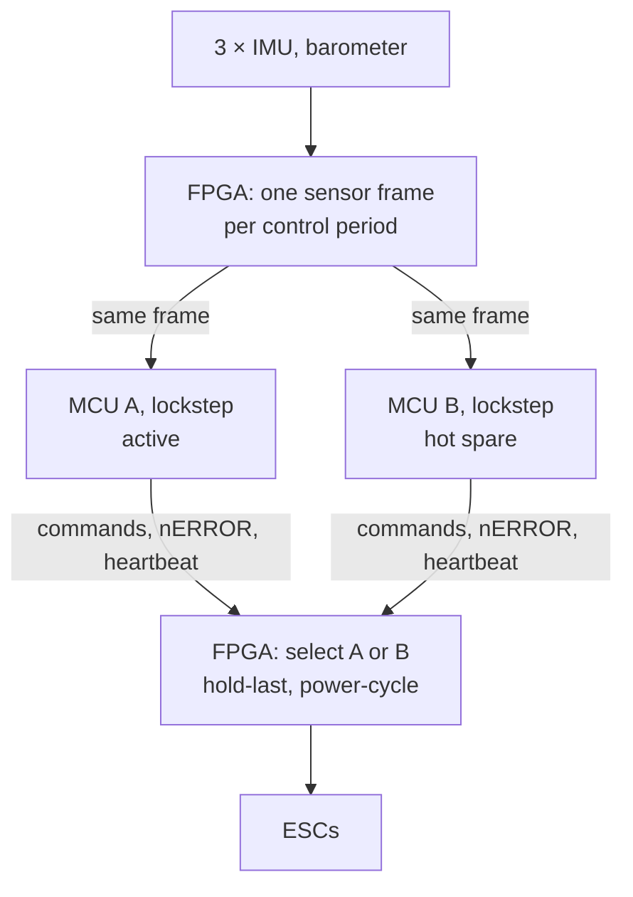

# ADR-02: Fault model and fault-tolerance pattern

← [ADR index](../../README.md#decision-records)

| | |
|---|---|
| **Status** | Proposed |
| **Date** | 2026-11-22 |
| **Depends on** | [ADR-01](ADR-01-mission-profile.md) (Proposed: multirotor profile, requirements R1 to R6) |
| **Decides** | which faults the flight computer has to survive, which redundancy pattern survives them, and how it degrades and recovers |

## Context

ADR-01 hands down six requirements. The two that shape this ADR: keep flying through a single fault of
one computing channel (R1), and never let an actuator command get older than one control period during
a failover (R2: 2 ms at 500 Hz, a target). ADR-01 also found the uncomfortable number for the FPGA: the
EP2C5 is SRAM-based and needs 47 to 61 ms to reconfigure after a configuration upset (R4).

The study started from two claims, which this ADR tests:

1. Voting three RTOS microcontrollers 2-out-of-3 in one FPGA fails naively on timing skew and value
   congruence; it needs a sequence-locked arrival window and mid-value select (MVS) with a tolerance
   band, not bitwise equality.
2. The FPGA becomes the single point of failure unless it stays small, deterministic and exhaustively
   verifiable ("asymmetric simplicity": no GNC, RTOS or autonomy on it).

§4 confirms the first claim for sensors and reverses it for commands. It also finds the second claim
the right rule for EAGLE, although the benchmark it is usually credited to (Ingenuity) has a large
FPGA that earns its trust in other ways.

## 1. Benchmarks

### Ingenuity: what flew

All from Balaram et al. [1] unless marked.

| Element | What it is and does |
|---|---|
| Architecture | "A three-level fault-tolerant computing architecture"; software on F´ |
| Navigation processor | Qualcomm Snapdragon 801, 2.26 GHz quad-core, 2 GB RAM, Linux. Velocity from features tracked in the VGA navigation camera, filter propagation for flight control, data management, commands, telemetry, radio. Talks to the flight controllers over UART. |
| Flight controllers | Two TI Hercules TMS570LC43x at 300 MHz, each a dual-core lockstep Cortex-R5F with ECC on flash and RAM. They "operate redundantly, receiving and processing identical sensor data"; "one of the MCU is active with the other waiting to be hot-swapped". They "run in sync and are provided with the same clock and data by the FPGA". |
| Fault detection and switch | "The lockstep mechanism does cycle by cycle error detection. If a fault is detected, it signals the error to the FPGA; the FPGA switches to the other processor and power cycles the faulty one, so the flight control software continues to run without disruption." |
| FPGA | Military-grade Microsemi ProASIC3L (flash configuration), -1 speed grade; TMR on critical flip-flops "as resources permit". All critical sensor and actuator I/O over 25 serial interfaces, brushless commutation (SVPWM) and servo PWM, power and thermal management, cell balancing, spacecraft time. "It operates the pair of FC processors as a primary and hot spare, determining when to switch from one to the other, and restoring critical state data to a processor after it has been power cycled. Critical data used by any of the processors is stored in the FPGA." |
| Sensor faults | Not tolerated in flight: "The helicopter won't try to continue its flight if a sensor fails" [3]. |

One detail the paper leaves open: it lists "vehicle flight control including an attitude control loop
operating at 500 Hz" among the FPGA's functions, and in another paragraph says the MCUs "perform the
flight-control functions". Where Ingenuity's 500 Hz control law executed is unresolved here.

### Ingenuity: why this design (inferred from [1]; JPL does not state the trade)

1. **The dominant fault was radiation.** COTS parts on Mars see single-event upsets and latch-up. The
   answers are per-chip cycle-level detection (lockstep and ECC), current monitors with power cycling to
   clear latch-up [1], and an always-on flash FPGA.
2. **Mass.** The helicopter had a 1,800 g not-to-exceed mass [1]. Lockstep makes each MCU fail-silent,
   and for fail-silent units one spare covers one fault, so a third computer buys nothing for that
   fault class.
3. **An unstable vehicle and short flights** (90 s to a few minutes [1]) need a failover "without
   disruption": a hot spare fed the same clock and data.
4. **The FPGA earns its trust from how it is built.** Flash configuration is
   immune to the upsets that SRAM FPGAs cannot prevent [4]; critical flip-flops are triplicated; there
   is no software. Its function list is long.
5. **The Linux tier stays outside the trusted loop.** It supplies velocity and runs communications. The
   sixth-flight anomaly, where one lost image shifted every later timestamp and the vehicle rolled and
   pitched more than 20° [5], shows what that tier can still do to the loop through its data.

### SpaceX Dragon and Falcon 9: what is public

SpaceX has not published its avionics architecture. Interviews give the outline: Dragon has three
computer units, each "two computers checking on each other", 54 processors in all; a radiation error
forces a pair to reboot, and the rebooted computer "needs to be re-synched" [6][7]. Falcon 9 has "three
computers in one unit on each engine" [6]. Dragon's software lead describes a "triple string computer
architecture" in which failures are detected and routed around [8]. How the strings' outputs are
combined (the "actor–judge" description, where each actuator controller decides which string to
follow) comes from secondary retellings of a conference talk and is **not verified** here.

**What both benchmarks share:** redundancy is built from fail-silent units (a lockstep chip, or a pair
of computers that check each other), and those units are then spared. Falcon 9 puts three computers in
a unit on each engine [6], so part of its redundancy sits downstream, at the engines. As far as the public
sources go, neither design puts three ordinary computers behind one central voter.

## 2. Fault model

T_c is the control period (2 ms at 500 Hz), W the arrival window for a channel's frame after the
FPGA's frame trigger (0.5 ms, *assumption*; ADR-04 sizes it from measured execution times).

| Id | Fault | Causes on Earth (examples) | What the FPGA sees | Detected by | Detection latency |
|---|---|---|---|---|---|
| F1 | Crash (fail-stop) | hard fault, brownout reset | frames and heartbeat stop | arrival-window timeout | ≤ W after the frame trigger |
| F2 | Hang or overrun | endless loop, priority inversion, task overrun | frame late or missing | arrival window; F´ reports a rate-group cycle slip as a WARNING_HI event [9] | ≤ W |
| F3 | Link corruption | EMI from motor wiring, a loose connector | CRC mismatch or sequence gap | CRC-16 and sequence number per frame | same frame |
| F4 | Silent computation error | upset in a register or ALU, marginal timing, undervoltage | a well-formed wrong frame | lockstep (CPU core only), cross-channel compare, plausibility | lockstep: within cycles; compare: same frame; heartbeat alone: never |
| F5 | Sensor fault | stuck output, bias jump, spikes, a dead sensor, vibration saturation | one IMU disagrees or goes silent | MVS with a tolerance band over 3 IMUs; range and rate checks | same frame; with 2 IMUs: detected, not isolated |
| F6 | Inconsistent inputs (Byzantine) | channels sample a sensor at different times; one copy of a broadcast corrupted | replicas compute from different inputs and diverge | one FPGA broadcast per period, plus each channel echoing the sequence number and CRC of the input frame it used | same frame |
| F7 | FPGA configuration upset | neutron upset in configuration SRAM | arbitrary change of the trusted logic | Cyclone II CRC_ERROR: a 32-bit CRC over the configuration SRAM, checked continuously in user mode [10] | one CRC pass: 1.8 ms to 0.45 s for the similar-size Cyclone EP1C6 [11]; no EP2C5 figure is published (measure) |
| F8 | Power and wiring | motor current transients, connector intermittency, vibration | looks like F1, F3 or F5 | as those, plus supply monitoring | as those |
| F9 | Common-mode software defect | the same bug in every replica, hit by the same input | identical wrong frames from every channel | nothing that compares replicas; only a diverse check (a Simplex envelope, plausibility) or verification | none |
| F10 | Supervisor design error | a bug in the FPGA logic | anything | review and formal verification (ADR-06); TMR does not help a design error | none |

Weights differ from Ingenuity's. For a vehicle on Earth, F7 is rare (no upset rate for the Cyclone II
was found to put a number on it), while F8 and F9 are the likely ones. The patterns transfer; the
reasons to pay for each piece of redundancy do not transfer unchanged.

## 3. Patterns

**P1: pair-and-spare with lockstep MCUs and an FPGA supervisor** (Ingenuity). Two lockstep MCUs, each
fail-silent for errors inside its CPU core, run in step on the same broadcast frames. One drives the
actuators; the other is a hot spare. The FPGA watches the lockstep error pin and the frame timing,
switches, holds the last good command, power-cycles the faulty channel and restores its state.

**P2: 2-out-of-3 vote in the FPGA.** Three MCUs of any kind compute the same frame from the same
broadcast; the FPGA aligns their output frames by sequence number inside the arrival window and votes.
A faulty channel is outvoted with no switchover event.

**P3: Simplex** (Sha [12]). A high-performance controller does the work; a simple, verified
high-assurance controller runs alongside; decision logic hands control to the simple one when the
state nears the edge of the region from which the simple controller is known to recover (a Lyapunov
level set inside the operating constraints). Simplex is aimed at *design* faults in the complex
controller. It does nothing for a hardware fault in the simple channel, so it sits on top of P1 or P2,
never in place of them.

**P4: asymmetric pair without lockstep.** Two ordinary MCUs, one active and one monitor computing the
same frame. Crashes and hangs are covered by the watchdogs; comparing the two outputs detects a silent
error but cannot say which channel made it.

## 4. Analysis

### Coverage

M = masked (the output stays correct), D = detected but not masked, – = not detected.

| Fault | P1 | P2 | P3 (over P1 or P2) | P4 |
|---|---|---|---|---|
| F1 crash, F2 hang | M | M | M | M |
| F3 link corruption | M (the other channel's copy of the same frame) | M | M | M if the monitor's frame is used |
| F4 silent error inside a CPU core | M (lockstep) | M | M | D |
| F4 silent error outside the core (peripheral, DMA, the link controller) | D with the A/B compare (§5), else – | M | M only if it drives the state toward the envelope | D |
| F5 one IMU (3 IMUs, MVS) | M | M | M | M |
| F6 inconsistent inputs | M with broadcast and echo | M with broadcast and echo | as P1/P2 | D |
| F7 FPGA configuration upset | D, then a 47 to 61 ms outage | D, outage | D, outage | D, outage |
| F9 common-mode software | – | – | M for bugs in the complex controller | – |
| F10 supervisor design error | – | – | – | – |

Only P2 masks silent errors outside the lockstep core without help, and nothing replicated masks F9
or F10. P4 fails R1 for silent errors: detection without isolation leaves only a fail-safe action, and a
multirotor has none.

### Failover latency against R2

| Event | P1 | P2 | P4 |
|---|---|---|---|
| Active channel crashes or hangs | detected at the window close; the spare's frame for the same period is already in the FPGA, so that frame goes out up to W late (0.5 ms) and nothing goes stale | no event; the frame is released when the second matching copy arrives | as P1 |
| Lockstep error on the active channel | nERROR from the MCU's error-signalling module; the FPGA takes the spare's frame for the current period, provided nERROR arrives before the faulty frame is accepted (the pin's latency has to be found in TI's documentation or measured, ADR-04) | not applicable | not applicable |
| Silent error outside the core | not masked; logged if compared | outvoted | detected at frame end, no safe choice of channel |
| FPGA configuration upset | 47 to 61 ms without actuators, plus detection | same | same |

P1, P2 and P4 all meet R2 for crashes and hangs, because a second channel has already computed the same
frame: the failover costs one arrival window (0.5 ms), a quarter of a control period. None meets R4
for F7 on a small multirotor.

### Claim 1: skew, congruence and the voter

- **Skew comes from separate clocks unless one clock owns the frame.** Two free-running crystals of
  ±50 ppm (*assumption*) differ by up to 100 ppm: 0.2 µs per 2 ms frame, but a full frame
  (2 ms ÷ 10⁻⁴) after 20 s. Channels that time their own loops drift a frame apart within a flight. Every
  channel therefore starts frame n on the FPGA's trigger, and the remaining skew is execution-time
  variation: W ≥ (WCET − BCET) + link jitter.
- **Sequence lock.** Every output frame names the input sequence number it was computed from. The voter
  compares only frames with equal numbers; a frame for n−1 arriving in window n is a timing fault (F2),
  not a vote.
- **Exact match versus MVS.** Exact (bitwise) match works when the replicas are deterministic and see
  identical inputs: the same binary, the same initial state, the same input frame (broadcast and echo),
  the same floating-point settings, and no dependence on arrival order of interrupts or threads. Under
  those conditions it is the stronger check: any divergence is caught. A tolerance band lets every
  error smaller than τ through and needs a τ justified per signal. MVS with a band belongs where values
  legitimately differ: three IMUs never agree bit for bit (the archived checklist already said so), or
  diverse channels. So the claim holds for sensors and is reversed for commands.
- **Why MVS masks.** With at most one faulty value among three, the median lies between the two good
  ones, min(g₁, g₂) ≤ median ≤ max(g₁, g₂), whatever the faulty one reads, so the voted error is
  bounded by the good sensors' spread. The median does the masking; the tolerance band only isolates the
  bad sensor (raises its fault flag).
- **The vote costs the median arrival.** A 2-out-of-3 voter can release the output as soon as two
  copies match; only the decision to exclude the third waits for the window to close.
- **Byzantine inputs.** Tolerating m arbitrary faulty participants by exchanging unsigned messages
  needs 3m + 1 of them, so 4 for one fault [13]. EAGLE avoids that by having a single distributor, the
  FPGA, broadcast one frame; the echo catches a copy corrupted on one link. It cannot protect against
  the FPGA itself, which is one more reason to keep the FPGA the simplest and best-verified element.

### Claim 2: the FPGA as single point of failure

True for every pattern here: P1 to P4 all route sensors and actuators through the FPGA. Ingenuity has
the same single point and pays for it with flash configuration, triplicated flip-flops and the absence
of software; its function list is long. For EAGLE, asymmetric simplicity is still the right rule,
for two reasons that do apply: the supervisor has to be simpler than the channels it judges so that its
state machine can be checked exhaustively (formal property checks, ADR-06), and on an SRAM part a
smaller design depends on fewer configuration bits, so fewer upsets change its behaviour.

What the EP2C5 cannot do that the ProASIC3 does, and what ADR-03 can do about it:

| Gap | EP2C5 | Options for ADR-03 |
|---|---|---|
| Configuration upsets | detected by CRC_ERROR; repaired only by full reconfiguration, 47.1 ms typical, 61.2 ms max [10] | accept as a residual risk for rig flights; route the ESC lines through a small hardware multiplexer that hands them to the active MCU when the FPGA drops out (the MCU then needs its own DShot generation); move the supervisor to a flash FPGA (ProASIC3, IGLOO2, or PolarFire, whose configuration cells are non-volatile [14]) |
| Cold start | power-on reset of at least 100 ms, then up to 61.2 ms of configuration [10] | hold the MCUs in reset until the FPGA is configured (external pull-downs, ADR-04); arm only after both are up |
| I/O during configuration | tri-stated with 10 to 50 kΩ weak pull-ups [10] | define every safety-relevant pin's level with an external resistor (ADR-04) |
| User flip-flops | ordinary flip-flops | TMR on the supervisor's state registers, as Ingenuity did; this protects the state, not the configuration |

## 5. Active and standby state

- **Hot by construction.** Both channels start every frame from the same broadcast input and run the
  same deterministic code, so their state stays equal without copying, as on Ingenuity.
- **Divergence monitor (option).** The FPGA compares A's and B's command frames every period. A mismatch
  without nERROR means a fault outside the lockstep core, or lost determinism; with two channels it
  cannot say which. Proposed policy: stay on the active channel, log the event, mark the spare suspect,
  and require a resynchronisation before it can take over.
- **Rejoin after a power cycle.** The restarted channel's state is restored from a copy, as Ingenuity
  restores it from the FPGA. Size, for a 10-state attitude filter (*assumption*): state 40 B,
  covariance upper triangle 220 B, integrators and mode about 64 B, so 0.3 to 0.5 KB. At 10 MHz SPI,
  0.5 KB (4,096 bits) takes 0.41 ms, inside one 2 ms frame. Streaming a fresh copy every frame would
  cost 250 KB/s, about 20% of a 10 MHz link; copying once from the running channel at rejoin costs
  nothing in steady state. ADR-04 chooses.
- **Proof of rejoin.** A restored channel counts as a spare only after K consecutive frames equal to
  the active channel's (K = 500, one second at 500 Hz, *target*).

## 6. Degradation and recovery

```mermaid
stateDiagram-v2
    [*] --> boot
    boot --> sync: FPGA configured
    sync --> nominal: both channels frame-locked, K equal frames
    nominal --> degraded: one channel faulted, the other drives
    degraded --> nominal: faulted channel power-cycled, restored, K equal frames
    degraded --> safe: fault on the remaining channel
    nominal --> safe: CRC_ERROR or a common-mode fault
    safe --> [*]
```

| State | Actuators | MCUs | Leaves when |
|---|---|---|---|
| boot | outputs at their resistor-defined safe level | held in reset | FPGA configured and its self-check passes |
| sync | disarmed | released, self-test, lock to the frame trigger, spare restored from active | both frame-locked and K equal frames |
| nominal | driven by the active channel | active and hot spare | any channel fault |
| degraded | driven by the remaining channel | faulted channel power-cycled and restored, or excluded | rejoin proven, or a second fault |
| safe | per vehicle: on the rig, motors stop; in free flight there is no safe action without a trusted channel, which is why the probability of a double fault has to be estimated and shown to be small | – | end of flight |

**Reset and power-cycle policy** (numbers are *targets* for the owner to set):

- Power-cycle a faulted channel; a reset alone leaves peripherals and latch-up states as they were.
  Ingenuity power-cycles [1].
- At most 3 power cycles per channel per flight; a channel that faults twice within 10 s stays out for
  the rest of the flight.
- No rejoined channel becomes active during takeoff or landing.
- Every transition is logged with timestamp and frame sequence (R6).
- Mode transitions are where supervisor logic bites. Ingenuity's first flight was delayed when a
  watchdog expired during the transition from "Pre-Flight" to "Flight" mode in a high-speed spin test
  [15]; the workaround, a change to the timing of the command sequence, was expected to get through the
  transition about 85% of the time [16]. Every transition above gets its own fault-injection test on the rig (R5).

## 7. If ADR-01 picks the rocket

The critical function becomes the pyro chain. Firing needs independent conditions (an MCU command, an
arm state held in the FPGA, a physical arm switch); outputs default to off through the configuration
window (ADR-04); deployment gets a second, independent path. Airbrake control tolerates seconds of
outage, so P4, or one MCU under an FPGA watchdog, meets the requirements; P1 stays a learning choice,
not a need.

## Recommendation

**P1: pair-and-spare with lockstep MCUs and an FPGA supervisor**, with four additions:

1. One broadcast sensor frame per period from the FPGA, and every MCU frame echoing the sequence number
   and CRC of the input frame it used (F6).
2. MVS with a tolerance band over three IMUs, if ADR-01 keeps three (ADR-03 decides whether the FPGA or
   the MCU runs it).
3. The A/B divergence monitor, logging first (§5).
4. The state machine and power-cycle policy of §6.

P1 meets R1 to R3 for crashes, hangs, link errors and silent errors inside the CPU core with the
smallest FPGA function of the fail-operational patterns: select, hold-last, watchdogs, power control
and a state store. It is the flown benchmark, and it puts error detection in the MCU's silicon, which
keeps the trusted element small.

Not recommended as the baseline:

- **P2** needs a three-way aligner, a voter and resynchronisation in the FPGA, and replica determinism
  across three boards, and it adds coverage only for silent errors outside the lockstep core. It is the
  alternative if ADR-03 rejects lockstep MCUs.
- **P3** answers design faults in complex software, which the two-tier baseline does not have. Defer it
  until a Tier 1 exists; it then sits on top of P1.
- **P4** cannot isolate a silent error, so it fails R1 on a multirotor. It is acceptable for the rocket
  and the rover.

## Consequences

- ADR-03's microcontroller choice narrows to lockstep parts: the TMS570LC43x (the part Ingenuity flew;
  big-endian), its little-endian twin the RM57L843, or an NXP S32K3 in lockstep mode. None has an F´
  reference port (ADR-05).
- Silent errors outside the lockstep core and common-mode software defects are detected at best and
  otherwise left to verification (ADR-05, ADR-06).
- The SRAM FPGA stays a single point of failure with a 47 to 61 ms outage on a configuration upset
  (R4): ADR-03 has to accept it, bypass it or replace the part.
- Replica determinism becomes a software requirement: the commanded path runs as passive F´ components
  on one rate group triggered by the FPGA frame, the pattern F´ itself recommends for cyclic work with
  hard deadlines [9] (ADR-05).
- On Earth, most of the safety will come from wiring, power and verification (F8, F9); the redundancy
  pattern covers the rarer faults.

## What would change this

- No lockstep MCU with a workable F´ and RTOS path (ADR-05's port spike fails): P2 with three ordinary
  MCUs.
- A Tier 1 (camera, autonomy) enters scope: P3 on top of P1.
- ADR-01 settles on the rocket: §7.
- A measured CRC pass plus reconfiguration that fits the real airframe's delay margin would settle R4
  without a new part; with 47 ms against an assumed 6 to 12 ms, that is unlikely.

## Decision needed from owner

1. Accept P1 (pair-and-spare, lockstep MCUs, FPGA supervisor) as the baseline? This limits ADR-03 to
   lockstep microcontrollers.
2. TMS570LC43x as flown (big-endian) or RM57L843 (little-endian, same core)? This can wait for ADR-03.
3. The SRAM FPGA as single point of failure: an accepted residual risk for rig flights, or must ADR-03
   evaluate an actuator bypass or a flash FPGA before free flight?
4. Fly through an IMU fault (three IMUs and MVS) or land on it, as Ingenuity does?
5. Include the A/B divergence monitor, logging first?
6. Power-cycle policy: 3 cycles per channel per flight, exclusion after two faults within 10 s,
   K = 500 equal frames to rejoin. Keep or change?
7. Common-mode software faults (Simplex) in Phase A scope, or deferred until there is a Tier 1?

## Sources

1. J. Balaram et al., "Mars Helicopter Technology Demonstrator," AIAA Atmospheric Flight Mechanics
   Conference, 2018, DOI 10.2514/6.2018-0023, §III.C (avionics computing, boards, FPGA).
   <https://rotorcraft.arc.nasa.gov/Publications/files/Balaram_AIAA2018_0023.pdf>
2. H. F. Grip et al., "Guidance and Control for a Mars Helicopter," AIAA GNC Conference, 2018,
   DOI 10.2514/6.2018-1849. <https://rotorcraft.arc.nasa.gov/Publications/files/Grip_AIAA2018_1849.pdf>
3. E. Ackerman, interview with T. Canham (JPL), "How NASA Designed a Helicopter That Could Fly
   Autonomously on Mars," IEEE Spectrum, 2021.
   <https://spectrum.ieee.org/automaton/aerospace/robotic-exploration/nasa-designed-perseverance-helicopter-rover-fly-autonomously-mars>
4. Actel, "ProASIC3 Flash Family FPGAs" datasheet, Advanced v0.6 ("Firm Errors": flash configuration
   cells cannot be altered by high-energy neutrons; live at power-up).
   <https://home.engineering.iastate.edu/~zambreno/classes/cpre583/2006/documents/actel/PA3_DS.pdf>
5. H. F. Grip, "Surviving an In-Flight Anomaly: What Happened on Ingenuity's Sixth Flight," NASA,
   27 May 2021. <https://science.nasa.gov/blog/surviving-an-in-flight-anomaly-what-happened-on-ingenuitys-sixth-flight/>
6. "Dragon's 'Radiation-Tolerant' Design," Aviation Week, 20 November 2012 (interview with J. Muratore).
   <https://aviationweek.com/dragons-radiation-tolerant-design>
7. A. Teitel, "Despite October Mishap, SpaceX's Computers Are a Go," AmericaSpace, 2 December 2012.
   <https://www.americaspace.com/2012/12/02/in-spite-of-octobers-mishap-spacexs-computers-are-a-go/>
8. "Don't push that button: Exploring the software that flies SpaceX starships," Stack Overflow blog,
   27 December 2021 (S. Gerding). <https://stackoverflow.blog/2021/12/27/dont-push-that-button-exploring-the-software-that-flies-spacex-starships/>
9. F´ v4.3.0 documentation: `docs/user-manual/design-patterns/rate-group.md` (cycle slip, WARNING_HI),
   `docs/user-manual/framework/component-and-port-selection.md` (cyclic work on sync ports),
   `Svc/Health/docs/sdd.md` (HTH-007: watchdog stroked only while pings return).
   <https://fprime.jpl.nasa.gov/latest/docs/user-manual/>
10. Altera, Cyclone II Device Handbook, Volume 1, February 2007: "Cyclone II Automated Single Event
    Upset Detection" (32-bit CRC, CRC_ERROR pin, 400 kHz to 80 MHz check clock), Chapter 4 (POR),
    Table 5–3 (R_CONF), Chapter 13 (EP2C5 AS configuration time).
    <https://www.cs.columbia.edu/~sedwards/classes/2008/4840/cyc2_cii5v1.pdf>
11. Altera, AN 357 "Error Detection Using CRC in Altera FPGA Devices," v1.0, July 2004, Table 6 (CRC
    calculation time; Cyclone II figures deferred to a later version).
    <https://hallaweb.jlab.org/tech/Detectors/public_html/manuals/chip_specs/A-L/altera/an357.pdf>
12. L. Sha, "Using Simplicity to Control Complexity," IEEE Software 18(4):20–28, 2001,
    DOI 10.1109/MS.2001.936213.
13. L. Lamport, R. Shostak, M. Pease, "The Byzantine Generals Problem," ACM TOPLAS 4(3):382–401, 1982.
14. Microchip, AC478 "Microchip PolarFire FPGAs for Safety Critical" application note (SEE-immune
    configuration).
    <https://www.microchip.com/content/dam/mchp/documents/FPGA/ApplicationNotes/ApplicationNotes/Microchip_PolarFire_FPGAs_for_Safety_Critical__AC478_Application_Note.pdf>
15. NASA, "Mars Helicopter Flight Delayed to No Earlier Than April 14," April 2021 (watchdog timer
    expiration during the Pre-Flight to Flight transition).
    <https://science.nasa.gov/blog/mars-helicopter-flight-delayed-to-no-earlier-than-april-14/>
16. M. Aung, "Why We Choose to Try Our First Helicopter Flight on Monday," NASA, 17 April 2021.
    <https://science.nasa.gov/blog/why-we-choose-to-try-our-first-helicopter-flight-on-monday/>

## History

| Date | Change |
|---|---|
| 2026-11-22 | Drafted; Proposed |
