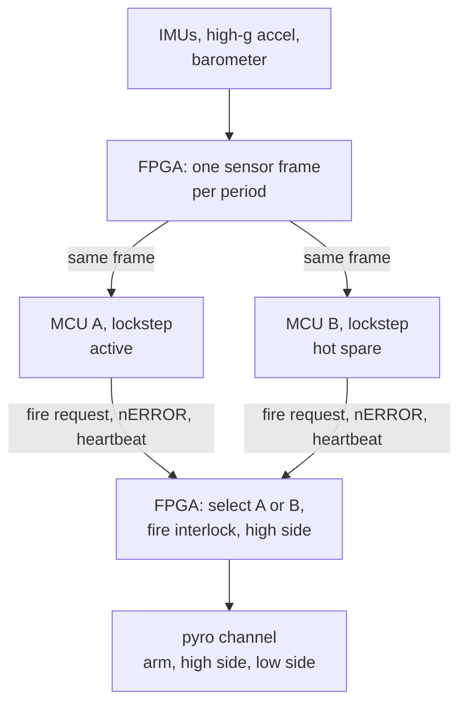
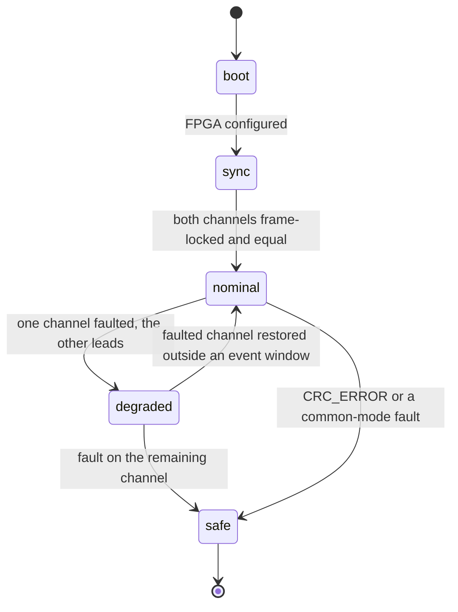

# ADR-02: Fault model and fault-tolerance pattern

← [ADR index](../../README.md#decision-records)

| | |
|---|---|
| **Status** | Proposed |
| **Date** | 2026-11-22 |
| **Depends on** | [ADR-01](ADR-01-mission-profile.md) (Accepted in part: sounding rocket, FlatSat; the phase budgets of its §3) |
| **Decides** | which faults the flight computer has to survive in which flight phase, which redundancy pattern survives them, who is allowed to fire a pyro channel, and how the computer degrades and recovers |

## Context

ADR-01 fixes the vehicle (a sounding rocket, stable on its fins) and derives, per flight phase, what a
fault may cost. From it this ADR takes seven requirements:

| Id | Requirement | From ADR-01 |
|---|---|---|
| R1 | No single fault fires a pyro channel in boost or coast (*target*) | §5 |
| R2 | No single fault of a computing channel stops the drogue firing within ±1.0 s of apogee, or the main within 4 s of the main altitude; faults of the firing hardware itself fall to an independent backup altimeter | §3c, §3d, §5 |
| R3 | In boost, the estimate survives an inertial gap of 8 ms, or apogee is confirmed by the barometer | §3a |
| R4 | In the apogee window, the fire path fails over within 100 ms (*target*) | §3c |
| R5 | Every failover path is demonstrated at least 299 times in a row on the FlatSat | §4 |
| R6 | Every fault, arm and fire event is logged with timestamp and frame sequence | §7 |
| R7 | An FPGA configuration upset is survivable in every phase, or recorded as an accepted risk | §9 (derived here, §4) |

The study started from two claims, tested in §4: voting three RTOS microcontrollers in one FPGA fails
naively on timing skew and value congruence and needs a sequence-locked window and mid-value select (MVS)
with a tolerance band, not bitwise equality; and the FPGA becomes the single point of failure unless it
stays small and exhaustively verifiable ("asymmetric simplicity").

T_f below is the frame period. The rocket has no inner control loop to set it; ADR-04 chooses it, and the
examples use 10 ms (100 Hz) and 2 ms (500 Hz). W is the arrival window for a channel's frame after the
FPGA's trigger, taken as T_f / 4 (*assumption*).

## 1. Benchmarks

### Ingenuity: what flew

All from Balaram et al. [1] unless marked.

| Element | What it is and does |
|---|---|
| Architecture | "A three-level fault-tolerant computing architecture"; software on F´ |
| Navigation processor | Snapdragon 801, Linux: velocity from tracked camera features, filter propagation, data management, commands, telemetry, radio; UART to the flight controllers |
| Flight controllers | Two TI Hercules TMS570LC43x at 300 MHz, each a dual-core lockstep Cortex-R5F with ECC on flash and RAM. They "operate redundantly, receiving and processing identical sensor data"; "one of the MCU is active with the other waiting to be hot-swapped"; they "run in sync and are provided with the same clock and data by the FPGA" |
| Fault detection and switch | "The lockstep mechanism does cycle by cycle error detection. If a fault is detected, it signals the error to the FPGA; the FPGA switches to the other processor and power cycles the faulty one, so the flight control software continues to run without disruption." |
| FPGA | Military-grade ProASIC3L (flash configuration), TMR on critical flip-flops "as resources permit"; 25 serial interfaces, motor commutation and servo PWM, power and thermal management, time; "It operates the pair of FC processors as a primary and hot spare ... and restoring critical state data to a processor after it has been power cycled." |
| Sensor faults | Not tolerated in flight: "The helicopter won't try to continue its flight if a sensor fails" [2]. |

The paper lists "vehicle flight control including an attitude control loop operating at 500 Hz" among the
FPGA's functions and elsewhere says the MCUs "perform the flight-control functions"; where the control
law ran is unresolved here. What carries over to a rocket is the fault-management structure, not the
control loop.

**Why JPL chose this** (inferred from [1]; JPL does not state the trade): radiation upsets in COTS parts
were the dominant fault, so each chip detects its own core errors (lockstep and ECC); with fail-silent
units one spare covers one fault, which suited a 1,800 g mass limit; a hot spare fed the same clock and
data gives a failover "without disruption"; and the FPGA earns its trust from flash configuration,
triplicated flip-flops and the absence of software. Its function list is long.

### SpaceX Dragon and Falcon 9

SpaceX has not published its avionics. Interviews give the outline: Dragon has three computer units,
each "two computers checking on each other"; a radiation error forces a pair to reboot, and the rebooted
computer "needs to be re-synched" [3][4]. Falcon 9 has "three computers in one unit on each engine" [3].
How the strings' outputs are combined (the "actor–judge" description) comes from secondary retellings
and is **not verified** here. Both benchmarks build redundancy from fail-silent units and then spare them;
neither, as far as public sources go, puts three ordinary computers behind one central voter.

### A rocket flight computer: TeleMega

The Altus Metrum TeleMega, a commercial high-power rocketry flight computer, is one computer: barometer,
high-g accelerometer, IMU and GPS, with a separate pyro battery and a switch [5]. It has no redundant
channel. That single-string design is the baseline EAGLE's redundancy has to improve on.

## 2. Fault model

| Id | Fault | Causes on a rocket (examples) | What the FPGA sees | Detected by | Detection latency |
|---|---|---|---|---|---|
| F1 | Crash (fail-stop) | hard fault, brownout during the ejection-charge current pulse | frames and heartbeat stop | arrival-window timeout | ≤ W |
| F2 | Hang or overrun | endless loop, priority inversion | frame late or missing | arrival window; F´ reports a rate-group slip as a WARNING_HI event [6] | ≤ W |
| F3 | Link corruption | EMI, a connector loosened by boost vibration | CRC mismatch or sequence gap | CRC and sequence number per frame | same frame |
| F4 | Silent computation error | register or ALU upset, marginal timing | a well-formed wrong frame, for example a wrong phase or an early fire request | lockstep (CPU core only), cross-channel compare, the FPGA's fire interlock (§5) | lockstep: within cycles; compare: same frame |
| F5 | Sensor fault | a dead or stuck sensor, saturation in boost, transonic pressure errors [7] | one sensor disagrees, clips or jumps | MVS over three IMUs, range and rate checks, barometer and accelerometer cross-checks | same frame |
| F6 | Inconsistent inputs (Byzantine) | channels sampling at different times; one copy of a broadcast corrupted | replicas diverge | one FPGA broadcast per period; each channel echoes the sequence number and CRC of the input it used | same frame |
| F7 | FPGA configuration upset | neutron upset in configuration SRAM | an arbitrary change of the trusted logic | Cyclone II CRC_ERROR: a 32-bit CRC over the configuration SRAM in user mode [8] | one CRC pass: 1.8 ms to 0.45 s for the similar-size Cyclone EP1C6 [9]; no EP2C5 figure is published (measure) |
| F8 | Power and wiring | boost vibration, ejection shock, battery sag | looks like F1, F3 or F5 | as those, plus supply monitoring | as those |
| F9 | Common-mode software defect | the same bug in both channels, for example a wrong apogee condition | identical wrong frames | nothing that compares replicas; the interlock (§5), verification, the backup altimeter | none |
| F10 | Supervisor design error | a bug in the FPGA logic | anything | review and formal verification (ADR-06) | none |
| F11 | Firing hardware fault | a switch stuck closed or open, an open or shorted e-match | continuity or switch-state monitor out of range | inhibit monitors, every frame [10] | same frame |
| F12 | False phase detection | a knock on the pad read as liftoff; a pressure spike read as apogee | a phase change too early | minimum-time and multi-frame conditions in the interlock | by design |

On Earth F7 is rare (no upset rate for the Cyclone II was found to quantify it); F8, F9 and F12 are the
likely ones.

## 3. Patterns, read for a rocket

**P1: pair-and-spare with lockstep MCUs and an FPGA supervisor** (Ingenuity). Both channels compute the
estimate, the phase and any fire request from the same frames. The FPGA accepts a fire request from either
channel once the interlock allows it, so a channel that crashes, raises its lockstep error or silently
fails to ask is covered by the other. Which channel is active matters for the airbrake command and for
whose estimate is logged.



**P2: 2-out-of-3 vote.** Three MCUs; a pyro fires on two matching requests.

**P3: Simplex** (Sha [11]): a complex controller, a simple verified one, and decision logic that keeps
the system inside the simple one's safe region. On a rocket it shrinks to the **fire interlock** of §5:
simple checks on raw data that bound whatever the complex estimator decides. It sits on top of any of the
other patterns.

**P4: asymmetric pair without lockstep.** Two ordinary MCUs, active and monitor, on the same frames. A
fire request passes if either channel asks and the interlock agrees: the interlock blocks an early
fire, the OR covers a missed one. A silent error still cannot be pinned to a channel.

## 4. Analysis

### Coverage

M = masked, D = detected but not masked, – = not detected.

| Fault | P1 | P2 | P4 |
|---|---|---|---|
| F1, F2 on the active channel | M (the spare's frame) | M | M |
| F3 link corruption | M (the other channel's copy) | M | M |
| F4 inside a CPU core | M (lockstep) | M | D |
| F4 outside the core | D with the A/B compare (§6), else – | M | D |
| F4 or F9 producing an early fire request | blocked by the interlock | outvoted (F4) or blocked (F9) | blocked by the interlock |
| F4 or F9 suppressing a needed fire | M for F4 in one channel (the other asks); F9 falls to the backup altimeter | M for F4; F9 to the backup | M for F4 (the other asks); F9 to the backup |
| F5 one IMU, three fitted | M | M | M |
| F6 inconsistent inputs | M with broadcast and echo | M | D |
| F7 FPGA configuration upset | see below | see below | see below |
| F11 firing hardware | D; a stuck-open high side falls to the backup | same | same |

The interlock and the backup altimeter carry most of the pyro safety for every pattern. What the patterns
still decide is how good the estimate stays and whether a fault can be pinned to a channel.

### Failover latency by phase

| Event | Boost (8 ms inertial budget) | Coast (0.5 s) | Apogee (100 ms fire path) | Drogue descent (4 s) |
|---|---|---|---|---|
| Active channel crashes or hangs, P1 or P4 | the spare never stopped integrating; nothing is lost | same | the spare's request, in the same frame or ≤ W later (2.5 ms at 100 Hz) | same |
| Lockstep error on the active channel, P1 | as above | same | the spare's request in the same frame; the switch of the active role takes ≤ T_f (10 ms at 100 Hz) | same |
| A channel fault, P2 | outvoted in the same frame | same | same | same |
| FPGA configuration upset (all patterns) | 47 to 61 ms without sensor frames: the inertial budget is broken, so R3 holds only through barometer-confirmed apogee; pyros were inhibited anyway | 47 to 61 ms against 0.5 s: met | see the budget below | 47 to 61 ms against 4 s: met |

**The FPGA upset at apogee, against R4's 100 ms:**

```text
reconfiguration (Active Serial, EP2C5)        ≤ 61.2 ms   [8]
CRC pass at the fastest check clock           ≈  1.8 ms   (EP1C6 analogue [9]; measure on the EP2C5)
restoring the interlock, max(2, N) frames     = 20 ms     (N ≤ 2 at 100 Hz: 2 frames of agreeing phase
                                                           reports, and N frames of rising pressure)
total                                         ≈ 83 ms     < 100 ms
```

It fits, but only with the CRC check clocked near its maximum and an interlock that can be restored from
the channels' reports; at the slowest check clock the pass alone could take 0.45 s, and the backup
altimeter would be firing the drogue. The drogue condition's N counts too: the restored interlock has no
pressure history, so it waits N fresh frames. At 100 Hz the budget holds for N ≤ 3 (61.2 + 1.8 + 30 =
93 ms); a larger N needs a faster frame or a shorter persistence.

A reconfiguration that starts during a fire pulse cuts the pulse short, because every pin returns to its
pull-up and the high side opens. The pulse is 50 ms by default on Altus Metrum flight computers [15],
about as long as the reconfiguration itself. Whether the restored interlock fires the channel again when
its continuity still reads intact is owner decision 8. Two further rules keep the upset survivable: the MCUs must not be
reset by the FPGA's reconfiguration (otherwise their estimate is lost; ADR-04 sets the reset line's
default to "not in reset"), and apogee must be confirmed by the barometer (R3).

So the SRAM part, a poor fit for the multirotor of ADR-01's §9, is acceptable for the rocket under three
rules: barometer-confirmed apogee, MCU resets decoupled from FPGA configuration, and a fast CRC check with
interlock restore. That is R7, met by design.

### Claim 1: skew, congruence and the voter

- **One clock owns the frame.** Two free-running ±50 ppm crystals (*assumption*) differ by up to 100 ppm,
  so channels that time themselves drift a frame apart after T_f ÷ 10⁻⁴: 100 s at 100 Hz, shorter than a
  flight with its descent. Every channel starts frame n on the FPGA's trigger; the remaining skew is
  execution-time spread, W ≥ (WCET − BCET) + link jitter.
- **Sequence lock.** Every output frame names the input sequence number it came from; only frames with
  equal numbers are compared.
- **Exact match versus MVS.** With one broadcast input and deterministic replicas, bitwise equality is
  the stronger check, and on a rocket the compared outputs are small: a phase, a fire request, perhaps an
  airbrake command. MVS with a tolerance band belongs on the sensors, which never agree bit for bit. The
  claim holds for sensors and reverses for commands.
- **Why MVS masks.** With at most one faulty value among three, the median lies between the two good
  ones, min(g₁, g₂) ≤ median ≤ max(g₁, g₂), whatever the faulty one reads. The tolerance band only
  isolates the bad sensor.
- **Byzantine inputs.** Tolerating m arbitrary faulty participants by exchanging unsigned messages needs
  3m + 1 of them [12]. A single distributor, the FPGA, avoids that; the echo catches a copy corrupted on
  one link, and nothing protects against the FPGA itself, which is why it stays the simplest and
  best-verified element.

### Claim 2: the FPGA as single point of failure

Still true: every pattern routes sensors and the high-side switch through the FPGA, and a fault that holds
the high side off defeats both channels, which is why R2 sends firing-hardware faults to the backup
altimeter. Asymmetric simplicity stays the rule: the FPGA's interlock is a handful of counters and
comparisons, small enough to prove properties of (ADR-06). On an SRAM part a smaller design also depends
on fewer configuration bits.

## 5. Who may fire

A proposal, after NASA's notional firing circuit: staged power through an arm inhibit, separate high-side
and low-side inhibits whose control sits in separate fault containment regions, and a monitor on every
inhibit [10].

| Stage | Controlled by | Closes when | During power-up and FPGA configuration |
|---|---|---|---|
| Arm switch: pyro battery to the pyro bus | a physical switch on the airframe | on the pad, by the flyer | open |
| Electronic arm: pyro bus to the channels | FPGA | in coast, once liftoff is latched, the minimum time since liftoff has passed and the high-g accelerometer shows no thrust | open |
| High side, per channel | FPGA | a fire request for the channel arrives from either MCU and the channel's own condition holds (drogue: pressure rising for N frames; main: pressure at or above that of the main altitude) | off; a pin pulled up must mean off (ADR-04) |
| Low side, per channel | MCU A or MCU B, wired-OR | that MCU's own fire decision | off |
| Monitors | MCUs (ADC) and FPGA | continuity and switch state, every frame | – |

- **Inadvertent fire in flight** needs the FPGA (electronic arm and high side, one fault containment
  region) and one MCU's low side to fail on: two independent faults, so R1's one-fault tolerance is met.
  On the pad with the arm switch open, no electronic fault fires anything.
- **Failure to fire:** a dead MCU leaves the other MCU's request and low side; an FPGA fault that holds the
  high side off defeats both, and the backup altimeter fires instead (R2).
- **The interlock is diverse from the estimator:** it reads raw pressure and raw high-g acceleration, not
  the MCUs' filtered state. A common-mode estimator bug (F9) cannot fire through it early.
- **After an FPGA reconfiguration** the interlock comes back disarmed with its latches cleared. Proposed:
  it re-arms only if both channels report the same phase, coast or later, for two consecutive frames.

## 6. Active and standby state

- **Hot by construction.** Both channels start every frame from the same broadcast and run the same
  deterministic code, so their estimates stay equal without copying, as on Ingenuity.
- **Divergence monitor (option).** The FPGA compares A's and B's output frames. A mismatch without nERROR
  means a fault outside the lockstep core, or lost determinism, and two channels cannot say which. Proposed
  policy: stay on the active channel, log, mark the spare suspect.
- **Rejoin after a power cycle.** The restarted channel's state is restored from the running one (about
  0.3 to 0.5 KB for a small attitude and altitude filter, *assumption*: 0.41 ms at 10 MHz SPI). A restored
  channel counts as a spare after one second of frames equal to the active channel's (*target*).

## 7. Degradation and recovery



| State | Pyro chain | MCUs | Leaves when |
|---|---|---|---|
| boot | arm switch open or electronic arm open; every output at its safe resistor-defined level | released into their own boot; arming waits for the FPGA's OK | FPGA configured and self-checked |
| sync | disarmed | self-test, lock to the frame trigger, spare restored from active | both frame-locked and equal |
| nominal | per phase (ADR-01 §3) | active and hot spare | any channel fault |
| degraded | per phase, on the remaining channel | faulted channel power-cycled and restored, or excluded | rejoin proven, or a second fault |
| safe | electronic arm open; recovery falls to the backup altimeter | – | landing |

**Power-cycle policy** (*targets* for the owner to set): at most three power cycles per channel per flight;
a channel that faults twice within 10 s stays out; no deliberate power cycle and no rejoin inside the
apogee window or within 4 s of the main altitude, because a rebooting channel cannot help there and its
inrush shares the battery with the firing pulse. Every transition is logged (R6) and has its own
fault-injection test on the FlatSat (R5). Mode transitions are where supervisor logic bites: Ingenuity's
first flight was delayed when a watchdog expired during the transition from "Pre-Flight" to "Flight"
mode [13], and the workaround was expected to get through the transition about 85% of the time [14].

## Recommendation

**P1, pair-and-spare with lockstep MCUs and an FPGA supervisor, with the fire chain of §5:** an FPGA fire
interlock built from simple checks on raw data, staged arming, a high side driven by the FPGA and a low
side by the MCUs, inhibit monitors, an independent backup altimeter, barometer-confirmed apogee, and the
three FPGA rules of §4 (resets decoupled from FPGA configuration, a fast CRC check, interlock restore by
agreement of both channels).

P1 keeps the estimate intact through any single channel fault in every phase, pins core errors to a
channel in hardware, and keeps the FPGA's job small. It is the flown benchmark.

- **P4 with the same fire chain is the fallback**, and closer to P1 on a rocket than on a multirotor:
  the interlock blocks early fires and the OR covers missed ones, so its remaining weakness, a silent
  error it cannot pin to a channel, costs estimate quality more than safety. It wins if lockstep MCUs fail
  the F´ port spike (ADR-05), because it opens the choice to parts F´ already supports.
- **P2 is not recommended:** a third MCU adds little once the interlock, the spare and the backup cover
  the pyro outcomes.
- **P3 is adopted in its small form,** as the interlock.

## Consequences

- ADR-03's microcontroller choice narrows to lockstep parts (TMS570LC43x as flown, big-endian; RM57L843;
  an S32K3 in lockstep mode), none with an F´ reference port, unless P4 takes over.
- The pyro chain needs its own pins and default states (ADR-04) and its own formal properties (ADR-06).
- A backup altimeter is part of the system design even though it is outside EAGLE's computer.
- Silent errors outside the lockstep core and common-mode software defects are handled by the interlock,
  the backup and verification, not by redundancy.

## What would change this

- The ADR-05 port spike fails on every lockstep MCU: P4 with the same fire chain.
- The owner wants two-fault tolerance against inadvertent fire: a third inhibit with its own control,
  for example a second electronic arm stage driven by the MCUs.
- A measured CRC pass on the EP2C5 far above the EP1C6 analogue, or an MCU that resets when the FPGA
  reconfigures: R7 fails at apogee, and the backup altimeter becomes the plan for that case.

## Decision needed from owner

1. Accept P1 with the fire chain of §5 as the baseline, and P4 with the same chain as the fallback if the
   lockstep port spike fails?
2. TMS570LC43x as flown (big-endian) or RM57L843 (little-endian)? This can wait for ADR-03.
3. Inadvertent-fire tolerance: one fault (proposed) or two, as NASA asks of crewed systems?
4. Low side driven by the MCUs directly (proposed: a separate fault containment region) or by the FPGA?
5. After an FPGA reconfiguration, re-arm from both channels' agreeing phase reports (proposed), or stay
   disarmed and leave recovery to the backup altimeter?
6. Include the A/B divergence monitor, logging first?
7. Power-cycle policy: three cycles per channel per flight, exclusion after two faults in 10 s, nothing
   inside the event windows. Keep or change?
8. A fire pulse cut short by an FPGA reconfiguration: fire again after the restore if the channel's
   continuity still reads intact, or leave the channel to the backup altimeter?

## Sources

1. J. Balaram et al., "Mars Helicopter Technology Demonstrator," AIAA 2018, DOI 10.2514/6.2018-0023.
   <https://rotorcraft.arc.nasa.gov/Publications/files/Balaram_AIAA2018_0023.pdf>
2. E. Ackerman, interview with T. Canham (JPL), IEEE Spectrum, 2021.
   <https://spectrum.ieee.org/automaton/aerospace/robotic-exploration/nasa-designed-perseverance-helicopter-rover-fly-autonomously-mars>
3. "Dragon's 'Radiation-Tolerant' Design," Aviation Week, 20 November 2012 (J. Muratore).
   <https://aviationweek.com/dragons-radiation-tolerant-design>
4. A. Teitel, "Despite October Mishap, SpaceX's Computers Are a Go," AmericaSpace, 2 December 2012.
   <https://www.americaspace.com/2012/12/02/in-spite-of-octobers-mishap-spacexs-computers-are-a-go/>
5. Altus Metrum, AltOS documentation, hardware specifications (TeleMega: MS5607, ADXL375, u-blox GPS,
   separate pyro battery and switch). <https://sources.debian.org/src/altos/1.9.16-2/doc/specs.inc>
6. F´ v4.3.0, `docs/user-manual/design-patterns/rate-group.md` (cycle slip, WARNING_HI).
   <https://fprime.jpl.nasa.gov/latest/docs/user-manual/>
7. US Patent 11,898,828, "Closed, self-contained ballistic apogee detection module and method."
   <https://image-ppubs.uspto.gov/dirsearch-public/print/downloadPdf/11898828>
8. Altera, Cyclone II Device Handbook, Volume 1, February 2007: "Cyclone II Automated Single Event Upset
   Detection," Chapter 4 (POR), Table 5–3 (R_CONF), Chapter 13 (EP2C5 AS configuration time).
   <https://www.cs.columbia.edu/~sedwards/classes/2008/4840/cyc2_cii5v1.pdf>
9. Altera, AN 357 "Error Detection Using CRC in Altera FPGA Devices," v1.0, July 2004, Table 6.
   <https://hallaweb.jlab.org/tech/Detectors/public_html/manuals/chip_specs/A-L/altera/an357.pdf>
10. NASA Engineering and Safety Center, Technical Bulletin 23-01, "Including Key Design Features in
    Safety-Critical Pyrotechnic Firing Circuits," 2023.
    <https://ntrs.nasa.gov/api/citations/20230001889/downloads/TB_23-01_Pyro%20Best%20Practices_031523.pdf>
11. L. Sha, "Using Simplicity to Control Complexity," IEEE Software 18(4):20–28, 2001,
    DOI 10.1109/MS.2001.936213.
12. L. Lamport, R. Shostak, M. Pease, "The Byzantine Generals Problem," ACM TOPLAS 4(3):382–401, 1982.
13. NASA, "Mars Helicopter Flight Delayed to No Earlier Than April 14," April 2021.
    <https://science.nasa.gov/blog/mars-helicopter-flight-delayed-to-no-earlier-than-april-14/>
14. M. Aung, "Why We Choose to Try Our First Helicopter Flight on Monday," NASA, 17 April 2021.
    <https://science.nasa.gov/blog/why-we-choose-to-try-our-first-helicopter-flight-on-monday/>
15. Altus Metrum, FAQ, "Why is the pyro 'on time' of your products only 50 milliseconds?" (fixed 50 ms on
    the apogee and main channels; programmable on TeleMega's other channels).
    <https://altusmetrum.org/FAQs/ontime.html>

## History

| Date | Change |
|---|---|
| 2026-11-22 | Drafted for the multirotor profile; Proposed |
| 2026-11-22 | Re-derived for the sounding rocket after ADR-01's owner decision: phase-by-phase latency, the EP2C5 upset against the rocket budgets, the fire chain (§5); still Proposed |
| 2026-11-23 | Apogee restore budget counts the interlock's N pressure frames; fire pulse cut by a reconfiguration added (owner decision 8) |
