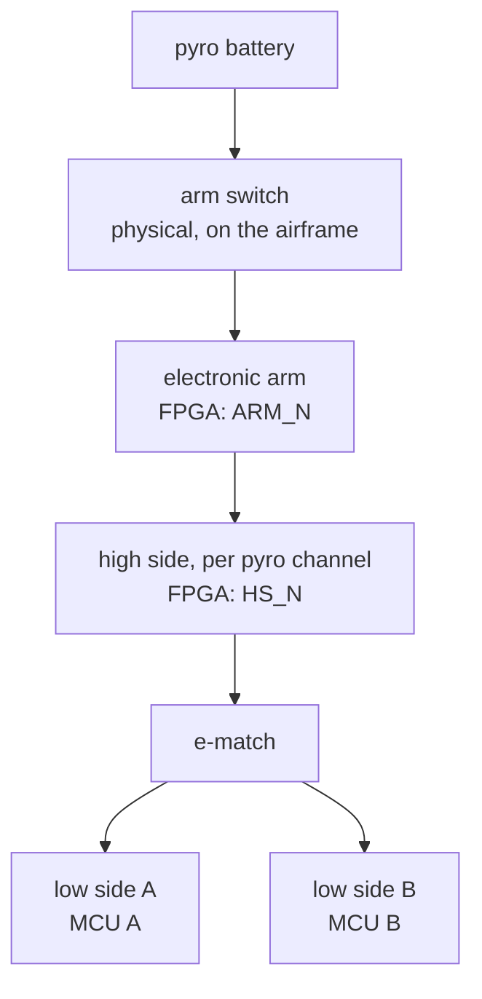

# ADR-04: Inter-chip links and interface control document

← [ADR index](../../README.md#decision-records)

| | |
|---|---|
| **Status** | Scoped |
| **Date** | 2026-11-22 |
| **Depends on** | [ADR-01](ADR-01-mission-profile.md) (Accepted in part: sounding rocket, FlatSat; sensors and pyro channels), [ADR-02](ADR-02-fault-tolerance.md) (pattern, broadcast and echo, the fire chain, the three FPGA rules), [ADR-03](ADR-03-partitioning.md) (which tier samples, which MCU) |
| **Decides** | the link and protocol for each chip pair, who owns the sample clock, the frame period, what a frame carries, the supervisor and pyro lines with their levels while the FPGA configures and while a channel is unpowered, and the per-frame timing budget |

## Context

ADR-02 asks the links for five things: one sensor frame broadcast to both channels per period; each
channel's reply echoing the sequence number and CRC of the input frame it used; a lockstep-error signal and
a heartbeat from each channel; reset and power control of each channel by the FPGA; and the pyro fire
chain of its §5 (electronic arm and high side from the FPGA, low side from either MCU, a monitor on every
inhibit). It also sets two rules this ADR has to honour in the pin levels: an FPGA reconfiguration must not
reset or power down the MCUs, and every pyro output must be off while the FPGA configures.

This ADR records the options and the arithmetic that constrains them. It fixes no bit layouts: the field
lists below say what a frame has to carry, and the layout is the owner's.

## Questions

1. FPGA to MCU: SPI, UART or classical CAN, and which side is master?
2. Who owns time, and what is the frame period T_f?
3. What does each frame carry (fields, not layout)?
4. Does a fire request travel in the uplink frame, on a discrete pin, or both?
5. Which supervisor and pyro lines, at which active level, and what must each read while the FPGA
   configures and while a channel is unpowered?
6. Who pulls nCONFIG when the FPGA reports CRC_ERROR?
7. FPGA to sensors: one SPI bus per sensor, or shared buses?
8. What is the per-frame timing budget at the chosen T_f?

## Frame period

A rocket has no inner control loop to set T_f (ADR-01 §3). What does set it:

| Driver | Number | Consequence for T_f |
|---|---|---|
| Barometer | MS5611 at its highest resolution (OSR 4096): 8.22 ms typical, 9.04 ms maximum per conversion [14]; pressure and temperature are separate conversions | one compensated pressure per 10 ms frame at most, temperature converted less often; a faster T_f gets a new pressure value only every few frames |
| Practice | AltOS runs "everything at 100 samples/second" on a 100 Hz tick, baked into its Kalman filters, with the barometer at "100 samples/sec max to get the full 24 bits" [13] | 100 Hz is a flown rate for this vehicle class |
| R3, inertial gap in boost | 8 ms (ADR-01 §3a); one lost frame leaves a gap of 2·T_f | T_f ≤ 4 ms (250 Hz or faster) to absorb one lost frame inertially; at 100 Hz R3 rests on barometer-confirmed apogee, as ADR-02 chose |
| Interlock restore at apogee | ADR-02 §4: 63 ms plus max(2, N) frames inside 100 ms | N ≤ 3 at 100 Hz; N ≤ 18 at 500 Hz |
| Accelerometers | ADXL375 to 3,200 Hz [15]; the ICM-42688-P faster still [7] | not binding |

Sample rate and frame rate do not have to be equal. The FPGA can read the IMUs and the high-g
accelerometer several times per frame and carry every sample in one frame, which gives the estimator a
fine-grained boost integration at a 100 Hz frame rate. The cost is frame length (below).

| Option | For | Against |
|---|---|---|
| 100 Hz, one sample per sensor per frame | AltOS practice; one pressure per frame; 10 ms for the commanded path | burnout integrated in 10 ms steps; R3 only through the barometer |
| 100 Hz frames, IMU and high-g sampled at 400 Hz or more | as above, with fine inertial samples | frames about 4 times longer in their inertial part; MVS runs per sample |
| 250 to 500 Hz | R3 met inertially with one lost frame | pressure repeats over several frames; 2 to 4 ms for the commanded path; CAN no longer fits |

## Link options, FPGA to MCU

| Link | Timing and throughput | Integrity | Fit | Notes |
|---|---|---|---|---|
| SPI, FPGA master | synchronous on the FPGA's schedule; 64 B at 10 MHz is 51.2 µs | no CRC or addressing in the protocol: both go in the frame | every candidate MCU has SPI (the TMS570LC4357 has five MibSPI modules [1]); the MCU receives with DMA | the FPGA owns timing end to end; point to point, so one channel's fault stays on its own link |
| SPI, MCU master | the MCU pulls frames (the archived plan's choice) | as above | as above | time ownership moves to the MCU unless an FPGA "frame ready" pin starts each read |
| UART | asynchronous, 10 bits per byte with start and stop; 64 B at an assumed 3 Mbaud is 213 µs | parity per byte at most; CRC in the frame | every candidate; Ingenuity's Snapdragon talks to its MCUs over UART [2] | fewest wires; receiver clock tolerance limits the rate |
| Classical CAN, 1 Mbit/s | worst case (55 + 10·s) bit times per frame with s data bytes, so 135 µs for 8 bytes [3]; a 32-byte message is 4 frames, up to 540 µs | CRC and acknowledgement in hardware | TMS570 and RM57 have DCAN (CAN 2.0B) [1][4]; the FPGA would need a CAN controller and a transceiver | fits at 100 Hz, not at 500 Hz; one shared bus (below) |
| CAN FD | up to 64-byte payload, faster data phase [5] | hardware CRC | not on the TMS570 or RM57; on the S32K344 and some STM32 families (ADR-03) | excluded by ADR-02's P1 MCU class |
| SpaceWire (the archived plan) | | | no shortlisted MCU has a SpaceWire peripheral | dropped |

**Classical CAN at 100 Hz.** Take a 32-byte message each way (*assumption*). The downlink is one broadcast,
up to 540 µs; two uplinks (P1) add up to 1,080 µs, three (P2) up to 1,620 µs. With the downlink, that is at
most 1.6 ms (P1) or 2.2 ms (P2) of bus time; in a 10 ms frame at 100 Hz, bandwidth does not rule CAN out. At 500 Hz it does: P1 would leave
at most 2,000 − 1,620 = 380 µs of computation per frame and P2 nothing (the earlier multirotor argument).

What still counts against CAN on a rocket is fault containment. Both channels and the FPGA share one bus,
so a node that keeps the bus busy (a "babbling idiot") blocks the other channel's uplink and the FPGA's
broadcast at once; the usual remedy is a bus guardian per node, a separate unit that cuts off a node
outside its transmit window [16]. Point-to-point SPI or UART keeps each channel's fault on its own wires.
A second, smaller cost: the CAN controller in the FPGA, which ADR-03's block table does not yet include.

## Time and sample ownership

- **Option under study: the FPGA is the time master.** A frame trigger every T_f starts the sensor reads,
  a free-running counter timestamps them, and one frame goes to both channels. ADR-02 gives the reason:
  channels that time themselves with ±50 ppm crystals drift a whole frame apart after T_f ÷ 10⁻⁴, 100 s at
  100 Hz, which is shorter than a pad wait plus a flight. Ingenuity's sixth flight gives the other: one lost
  image left every later image with a wrong timestamp, and the estimator followed them [6].
- **Shared IMU clock.** The ICM-42688-P accepts an external clock for its sample timing [7], so one FPGA
  pin can lock all three IMUs' output data rates to the FPGA's time base. The residual phase between the
  three IMUs' sampling instants still has to be measured (E4-3).
- **Barometer schedule.** The FPGA starts each conversion and reads the result one conversion time later
  (≤ 9.04 ms at OSR 4096 [14]), so the pressure in frame n was sampled during frame n − 1. The frame says
  so through the pressure's own timestamp.
- **Counter widths.** The flight computer is powered on the pad before launch, possibly for an hour or more
  (*assumption*). A 32-bit timestamp at 50 MHz wraps after 2³² ÷ 50 MHz = 85.9 s; at 1 µs resolution after
  71.6 minutes, which a long pad hold can exceed. A 16-bit sequence number wraps after 65,536 frames,
  10.9 minutes at 100 Hz; a 32-bit one after 497 days. Either the counters are wide enough for a powered
  session, or every comparison uses serial-number arithmetic [8].

## Frame contents (fields, not layout)

**Downlink, FPGA to both channels, once per period**

| Field | Purpose |
|---|---|
| sync word | regain frame alignment after a slip |
| type and ICD version | refuse a mismatched build at boot |
| sequence number | monotonic frame counter; replies are matched against it |
| timestamp | FPGA time of the sample trigger; the pressure carries its own |
| sensor data | 3 IMUs, the high-g accelerometer, the barometer's raw counts; raw or after MVS (ADR-03, Q5) |
| sensor status | per-sensor flags, MVS isolation result |
| supervisor state | mode, which channel is active |
| interlock state | liftoff latched, time since liftoff, electronic arm, per-channel permissive, fire pulse in progress |
| pyro monitors | continuity and switch states as the FPGA reads them |
| CRC | over the whole frame |

**Uplink, each channel to the FPGA, once per period**

| Field | Purpose |
|---|---|
| sync word, type | as above |
| echo of the input sequence number and input CRC | input-congruence check (ADR-02, F6) |
| flight phase | the channel's phase; both channels' agreeing reports restore the interlock after a reconfiguration (ADR-02 §5) |
| fire requests, per pyro channel | if carried in the frame (Q4) |
| airbrake command | if airbrakes are fitted (ADR-01 decision 4) |
| channel status | self-test result, F´ health, rate-group slips, the channel's own ADC continuity readings |
| state copy (optional) | for rejoin after a power cycle (ADR-02 §6) |
| CRC | over the whole frame |

**CRC.** A CRC of degree r catches every burst error up to r bits; beyond that, the polynomial should be
chosen by its Hamming distance at the actual frame length, which differs a lot between common
polynomials [9]. CRC-8 against CRC-16 is decided on that table once the frame length is known.

**Frame length.** Three IMUs at 12 bytes each (accelerometer and gyroscope, 16 bits per axis), 6 bytes
of high-g acceleration and 3 bytes of pressure come to 45 bytes of sensor data per sample set; with the
other fields, a 64-byte downlink at one sample per frame is the working *assumption*. Four inertial samples
per frame add about 3 × 42 = 126 bytes.

## Fire requests: frame field or discrete pin

| Option | For | Against |
|---|---|---|
| Field in the uplink frame | CRC-protected and tied to a sequence number, so a stale or corrupted request cannot fire; no pins | depends on the frame engine working; arrives once per frame |
| Discrete pin per pyro channel per MCU | independent of the link and the frame engine; 4 pins for P1 | a stuck pin is a standing request; the interlock and the low side still have to agree, so it cannot fire alone (ADR-02 §5) |
| Both, and the FPGA requires both | two independent paths must agree | the pins of the second option; a fault in either path blocks the request, which the other channel covers |

## Fire chain lines

The two low-side switches sit in parallel, one per MCU, which is ADR-02's "wired-OR": either MCU can
complete the circuit and neither can block the other. A diode-OR of the two MCU outputs into one switch is
the other option. The fire pulse length is set by the FPGA's timer on the high side; 50 ms is the default
on Altus Metrum flight computers, chosen to fire an e-match reliably without draining the battery [12].

## Supervisor and pyro lines

| Signal | Direction | P1 count | Must read while the FPGA configures | Must read with the channel unpowered | Purpose |
|---|---|---|---|---|---|
| HB | MCU to FPGA | 2 | (FPGA input) | no toggle: a fault | heartbeat; F´'s Svc.Health strokes its watchdog output only while every pinged component answers [10] |
| nERROR | MCU to FPGA | 2 | (FPGA input) | low, "error": a pull-down at the FPGA side | the TMS570's error-signalling module pin [1] |
| ACTIVE_N | FPGA to MCU | 2 | high, "not active" | – | tells each channel whether its airbrake command is used |
| FPGA_OK_N | FPGA to MCU | 1 or 2 | high, "not OK" | – | the supervisor is configured and passed its self-check; arming waits for it |
| MCU_RST_N | FPGA to MCU | 2 | high, "not in reset" | – | resets a channel; a reconfiguration must not reset the MCUs (ADR-02 §4) |
| PWR_EN | FPGA to the channel's regulator | 2 | high, "on" | – | power-cycles a channel; a reconfiguration must not cut power |
| CRC_ERROR | FPGA to the nCONFIG source (Q6) | 1 | – | – | reports a configuration upset [11] |
| ARM_N | FPGA to the electronic arm switch | 1 | high, "open" | – | electronic arm stage |
| HS_N | FPGA to the high-side driver | 2 | high, "off" | – | high side, per pyro channel |
| LS | MCU to its low-side switch | 4 (2 per MCU) | (MCU output) | off: a pull-down at the switch | low side, per pyro channel per MCU |
| fire request | MCU to FPGA | 0 or 4 | (FPGA input) | no request | only if discrete (Q4) |
| pyro monitors | switch and continuity circuits to FPGA | 8 | (FPGA input) | – | continuity and high-side and low-side state per pyro channel, electronic arm state, arm switch sense |

**Levels while the FPGA configures.** Before and during configuration, and again during every
reconfiguration started by nCONFIG, every EP2C5 user I/O is tri-stated with a weak pull-up of 10 to
50 kΩ [11]. Every FPGA output is therefore chosen so that "high" is its safe state: active-low for anything
that acts (arming, the high side, ACTIVE_N, FPGA_OK_N), active-high for anything that must stay on through a
reconfiguration (PWR_EN, and MCU_RST_N not asserted). This fits the workspace's active-low convention, and it
replaces the earlier draft, which held the MCUs in reset through an external pull-down while the FPGA
configured: ADR-02 has since made that a failure, because the MCUs would lose their estimate at apogee.

A 10 to 50 kΩ pull-up is weak against noise on a harness. Each line gets an external resistor that sets the
same level on its own, sized against the receiving pin's thresholds and the FPGA's 4 mA minimum LVTTL drive
setting [11] (E4-6).

**Back-powering.** When PWR_EN cuts a channel, every FPGA output into it (SPI clock and data, frame trigger,
ACTIVE_N, MCU_RST_N) can feed current into the unpowered MCU through its input protection diodes and keep
it partly alive, so the power cycle may not reset it. This is general CMOS behaviour, not a figure from a
datasheet; the bound is the chosen MCU's absolute maximum input voltage. The options are to drive those
lines low or tri-state them before cutting power, to put series resistors on them, or to buffer the
channel's inputs with a part that isolates when unpowered (E4-7).

**Who pulls nCONFIG.** The Cyclone II's CRC_ERROR pin only reports an upset; the handbook leaves the
reconfiguration to the user, who "can monitor one external pin for the error and use it to trigger a
re-configuration cycle" [11]. Pulling nCONFIG low starts it [11].

| Option | For | Against |
|---|---|---|
| Either MCU, open-drain onto nCONFIG | the MCUs know the phase, so they can hold a reconfiguration until a fire pulse has finished (ADR-02 decision 8) | one faulty MCU can take the supervisor down for 61 ms; nCONFIG becomes part of the ICD |
| A small external circuit: CRC_ERROR to an nCONFIG pulse | independent of both MCUs | cannot wait for a fire pulse to end |
| No reconfiguration in flight: log the upset and fly on | no 61 ms outage | the FPGA flies with an unknown configuration fault; the upset may sit in unused bits or in the interlock |

## Signal count

The count feeds ADR-03's I/O row. It is a count by group, not a pinout.

| Group | P1 low | P1 high | Basis |
|---|---|---|---|
| Sensor SPI | 11 | 20 | low: one bus for the three IMUs (4 + 2 extra chip selects) and one for the high-g accelerometer and the barometer (4 + 1); high: one 4-wire bus per sensor |
| Sensor interrupts, IMU external clock | 5 | 5 | 3 IMU and 1 high-g data-ready, 1 clock |
| MCU links, SPI with a frame trigger | 10 | 10 | 5 per channel |
| Supervisor lines | 11 | 12 | HB, nERROR, ACTIVE_N, MCU_RST_N, PWR_EN per channel; FPGA_OK_N shared or per channel |
| Discrete fire requests | 0 | 4 | Q4 |
| Pyro outputs and monitors | 11 | 11 | ARM_N, 2 × HS_N, 8 monitors (the LS lines are MCU pins) |
| CRC_ERROR, airbrake servo, debug UART | 3 | 4 | servo only if fitted |
| **Total, P1** | **51** | **66** | |

P2 adds a third channel: 5 link pins, 5 or 6 supervisor lines and 0 or 2 fire requests, so 61 to 79. A
second high-g accelerometer and a second barometer add 3 to 9. Against the EP2C5's 89 package I/O (66 at
the 75% ceiling, ADR-03), P1 fits at the low end and reaches the ceiling at the high end, and the board's
header count is lower still (E3-2). Pins bind before logic elements do.

The low end has a cost that the count hides: on a shared IMU bus, one sensor that holds MISO in a fixed
state takes out all three, and MVS assumes independent failures. One bus per IMU keeps a sensor fault on
its own wires; it costs 6 pins.

## Timing budget per frame at 100 Hz

*Targets and derivations; the 64-byte frame and the 10 MHz SPI clock are assumptions.*

| Step | Time | Origin |
|---|---|---|
| Frame trigger to the end of the sensor reads, separate buses: IMU bursts of 15 bytes at 10 MHz (12 µs); ADXL375, 7 bytes at its 5 MHz maximum [15] (11.2 µs); barometer result, 4 bytes (3.2 µs) | 12 µs (26 µs on shared buses) | derived |
| Frame build and CRC, one byte per clock at 50 MHz | 1.3 µs | derived |
| Broadcast, 64 B at 10 MHz SPI | 51 µs | derived |
| Commanded path on the MCU, worst case | ≤ 5,000 µs | target; WCET measured in ADR-05 |
| Uplink, 64 B at 10 MHz | 51 µs | derived |
| Select, interlock, fire decision | < 1 µs | a few FPGA clocks |
| **Trigger to the last acceptable uplink** | **about 5.1 ms of the 10 ms period** | |

ADR-02's arrival window W = T_f / 4 = 2.5 ms bounds the spread of the commanded path's execution time:
WCET − BCET + link jitter ≤ 2.5 ms (*assumption* until E5-4 measures it). The nominal fire latency, from the
frame in which the interlock's condition becomes true to the high side closing, is at most one frame plus
this path, about 15 ms: small against the ±1.0 s apogee window. At 500 Hz the same steps leave about
1.9 ms for the commanded path.

## Evidence that would settle this ADR

| Id | Evidence |
|---|---|
| E4-1 | GHDL simulation of the frame engine with corrupted, missing, late and reordered frames (after Phase A) |
| E4-2 | Logic-analyzer capture of the real link timing on the FlatSat, including the MCU's DMA latency |
| E4-3 | Spread of the three ICM-42688-P sampling instants on a shared external clock |
| E4-4 | A scope on every supervisor and pyro line on the FlatSat through power-up, an FPGA reconfiguration (nCONFIG pulsed) and a channel power cycle: each line holds its safe level throughout |
| E4-5 | nERROR latency on the chosen lockstep MCU, from TI's documentation or by fault injection |
| E4-6 | The chosen MCU's input thresholds, reset pin pull-up and GPIO state during reset, to size the external resistors |
| E4-7 | The chosen MCU's absolute maximum input ratings, and a FlatSat test that a power cycle resets a channel while the FPGA still drives its link |
| E4-8 | The barometer's conversion schedule at the chosen OSR against T_f |

## Sources

1. TI, TMS570LC4357 product page (five MibSPI, four DCAN, error-signalling module and nERROR pin).
   <https://www.ti.com/product/TMS570LC4357>
2. J. Balaram et al., "Mars Helicopter Technology Demonstrator," AIAA 2018, DOI 10.2514/6.2018-0023.
   <https://rotorcraft.arc.nasa.gov/Publications/files/Balaram_AIAA2018_0023.pdf>
3. R. I. Davis, A. Burns, R. J. Bril, J. J. Lukkien, "Controller Area Network (CAN) schedulability
   analysis: Refuted, revisited and revised," Real-Time Systems 35:239–272, 2007,
   DOI 10.1007/s11241-007-9012-7; worst-case frame time with 11-bit identifiers C = (55 + 10·s)·τ_bit,
   as stated in the authors' presentation <https://www-users.york.ac.uk/~rd17/papers/UpdatedCANPresentation.pdf>.
4. TI, RM57L843 product page. <https://www.ti.com/product/RM57L843>
5. CAN in Automation, "CAN FD: the basic idea." <https://can-cia.org/can-knowledge/can-fd-the-basic-idea>
6. H. F. Grip, "Surviving an In-Flight Anomaly: What Happened on Ingenuity's Sixth Flight," NASA, 2021.
   <https://science.nasa.gov/blog/surviving-an-in-flight-anomaly-what-happened-on-ingenuitys-sixth-flight/>
7. TDK InvenSense, ICM-42688-P product brief PB-000072. <https://www.farnell.com/datasheets/3045877.pdf>
8. R. Elz, R. Bush, "Serial Number Arithmetic," RFC 1982, 1996.
9. P. Koopman, T. Chakravarty, "Cyclic Redundancy Code (CRC) Polynomial Selection for Embedded
   Networks," DSN 2004, pp. 145–154, DOI 10.1109/DSN.2004.1311885.
10. F´ v4.3.0, `Svc/Health/docs/sdd.md`, requirement HTH-007.
11. Altera, Cyclone II Device Handbook, Volume 1, February 2007: Table 2–16 (LVTTL drive strengths 4 to
    24 mA), ch. 3 ("Cyclone II Automated Single Event Upset Detection": CRC_ERROR reports, the user
    triggers reconfiguration), Table 5–3 (R_CONF), ch. 13 (weak pull-ups before and during configuration;
    Figure 13–12: "When nCONFIG is pulled low, a reconfiguration cycle begins").
    <https://www.cs.columbia.edu/~sedwards/classes/2008/4840/cyc2_cii5v1.pdf>
12. Altus Metrum, FAQ, "Why is the pyro 'on time' of your products only 50 milliseconds?"
    <https://altusmetrum.org/FAQs/ontime.html>
13. K. Packard, "TeleMega Questions," altusmetrum mailing list, 15 November 2013.
    <https://www.mail-archive.com/altusmetrum@lists.gag.com/msg00401.html>
14. TE Connectivity, MS5611-01BA03 data sheet (conversion time at OSR 4096: 7.40 / 8.22 / 9.04 ms
    min / typ / max).
    <https://static6.arrow.com/aropdfconversion/9b400750fb9e045bbfb60b6c883d793ed0702c5d/engdsms561101ba03b3.pdf>
15. Analog Devices, ADXL375 data sheet (output data rate 0.1 to 3,200 Hz; SPI clock 5 MHz maximum; the
    1,600 and 3,200 Hz rates need SPI at 2 MHz or more). <https://www.analog.com/en/products/adxl375.html>
16. I. Broster, A. Burns, "An Analysable Bus-Guardian for Event-Triggered Communication," IEEE Real-Time
    Systems Symposium, 2003. <https://www.cs.york.ac.uk/rts/publications/Broster2003.html>

## History

| Date | Change |
|---|---|
| 2026-11-22 | Scoped for the multirotor profile |
| 2026-11-23 | Rescoped for the sounding rocket and FlatSat: frame period opened (100 Hz practice, barometer conversion time, R3), classical CAN reassessed at 100 Hz, DShot and ESC rows replaced by the fire chain lines, MCU_RST_N and PWR_EN default to "on" through a reconfiguration (the pull-down derivation dropped), nCONFIG ownership, back-powering and a signal count added |
