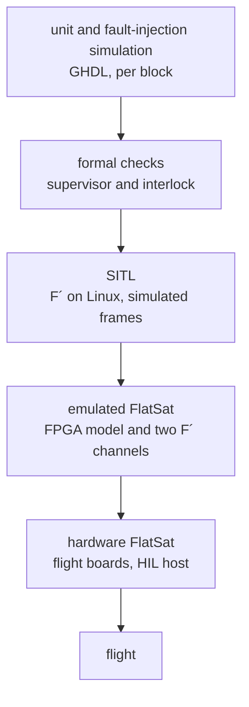

# ADR-06: HDL and software-first verification

← [ADR index](../../README.md#decision-records)

| | |
|---|---|
| **Status** | Scoped |
| **Date** | 2026-11-22 |
| **Depends on** | [ADR-01](ADR-01-mission-profile.md) (Accepted in part: FlatSat test approach, its §4 and §8), [ADR-02](ADR-02-fault-tolerance.md) (fault model, fire chain, R5), [ADR-03](ADR-03-partitioning.md) (the FPGA part and what logic it holds), [ADR-04](ADR-04-interchip-icd.md) (what the frame engine and the pin levels must do), [ADR-05](ADR-05-flight-software.md) (the SITL platform) |
| **Decides** | the HDL for the supervisor, the simulation, fault-injection and formal setup, the SITL and the emulated FlatSat, and how the hardware FlatSat stimulates sensors, injects faults and runs the failover campaigns |

## Context

ADR-02 makes the FPGA the trusted element and asks it to stay small enough to verify exhaustively. ADR-01
makes the FlatSat the place where the flight computer is integrated and where every failover path is shown
at least 299 times in a row, because a stable rocket shows nothing about failover in flight (ADR-01 §4).
This ADR decides how both get their evidence. The order is software first: every block, every fault path
and the whole frame loop run in simulation, then on an emulated FlatSat, before the hardware FlatSat is
wired.

The owner is learning VHDL and prefers it for its strong typing and its standing in European space and
avionics work, while knowing that the ETH systems groups' FPGA work is in SystemVerilog and HLS. The
table below checks both reasons.

## Questions

1. VHDL-2008 or SystemVerilog for the EP2C5, or for its replacement if ADR-03 changes the part?
2. Unit and fault-injection simulation: GHDL with VUnit, cocotb, or both?
3. Formal checks of the supervisor's state machine: which tools, which properties?
4. SITL: where do the flight profiles come from, and what drives simulated time?
5. An emulated FlatSat (the FPGA model and the F´ channels exchanging frames in software): worth it, and
   for which tests?
6. On the hardware FlatSat, how do the sensors see a flight: real sensors, emulators on the flight SPI
   buses, or an injection mode in the FPGA?
7. How is each fault of ADR-02's model injected on the FlatSat, and how is a 299-trial campaign run?

## Toolchain facts for the EP2C5

| Fact | Consequence |
|---|---|
| Quartus II 13.0sp1 is the last release that supports Cyclone II; support was removed in 13.1 [1] | one toolchain, frozen since 2013 |
| Quartus is an x86 program | synthesis runs on the x86 laptop or the Windows machine; the Raspberry Pi can only simulate |
| Earlier Quartus projects in this workspace found Quartus 13 reading VHDL-93 by default and rejecting non-ASCII characters even in comments | sources stay ASCII; VHDL-2008 needs a project setting, and Intel documents its VHDL-2008 support as a list of supported constructs [2] |
| SystemVerilog support in Quartus II 13.0 is also partial; the exact list was not checked | E6-1 |
| Yosys's `synth_intel` targets MAX 10, Cyclone 10 LP and Cyclone IV only [3]; nextpnr's only Intel target is Cyclone V, through Mistral, marked experimental [4] | there is no open path from HDL to an EP2C5 bitstream |
| GHDL 2.0.0 is installed on the Pi, and its `synth` command is present (checked locally) | open simulation now, and a netlist for formal checks through `ghdl-yosys-plugin`, whose authors call GHDL's synthesis beta and its PSL support partial [5] |

## HDL options

| | VHDL-2008 | SystemVerilog |
|---|---|---|
| Typing | strong: enumerated FSM states, records and ranged integers are checked by the compiler | weaker by default (implicit conversions, `logic` everywhere); closer with `typedef enum`, packages and `` `default_nettype none `` |
| EP2C5 toolchain | Quartus II 13.0sp1: VHDL-93 by default, a 2008 subset | Quartus II 13.0sp1: a subset |
| Open simulation | GHDL (installed on the Pi), NVC | Verilator, Icarus Verilog (neither installed; both cover SystemVerilog partially) |
| Open formal | GHDL with `ghdl-yosys-plugin` and SymbiYosys, PSL properties [5] | Yosys's own front end (a subset) with SymbiYosys |
| Avionics assurance | DO-254 is language-neutral: FAA Order 8110.105A asks the applicant to define coding standards for whichever HDL is used and to review conformance [6][7] | same |
| European space practice | ESA's VHDL Modelling Guidelines (ASIC/001, 1994, VHDL-93) [8]; Gaisler's GRLIB IP library and the LEON3 processor are VHDL [9] | |
| ETH systems research | | Coyote, "an operating system for FPGAs": hardware in SystemVerilog (`hw/hdl/*.sv`), user logic in RTL or HLS, built with AMD Vivado [10] |
| This workspace | every synthesizable repo is VHDL (`UART_TX`, `state-machine-counter`, `vHDL-mini-project`) | none |

The DO-254 reason does not hold as stated: the guidance does not favour VHDL. The European-space reason
does (ESA's guidelines, GRLIB). The ETH reason points to SystemVerilog, but on this part SystemVerilog
gets the same frozen, partial toolchain as VHDL; it would matter more after a move to a newer FPGA.

## Verification layers, software first



1. **Unit simulation** of each block, self-checking: GHDL with VUnit (MPL-2.0, GHDL among its supported
   simulators [11]), or cocotb in Python (GHDL 2.0 and later through VPI, which hides some VHDL-specific
   constructs such as 9-value signals [12]).
2. **Fault injection in simulation**: corrupted, missing, late and reordered frames; a stuck or late
   nERROR; heartbeat loss; IMU faults for MVS; a stuck sensor MISO; the CRC_ERROR path; a reconfiguration
   in the middle of a fire pulse.
3. **Formal checks of the supervisor and the interlock** with SymbiYosys, bounded and unbounded. Candidate
   properties:
   - the electronic arm never closes before liftoff is latched and the minimum time has passed;
   - a high side never closes without its channel's own condition, and never for longer than the fire
     pulse;
   - after a reset or reconfiguration, the electronic arm and both high sides stay open until both
     channels report the same phase, coast or later, for two consecutive frames (ADR-02 §5);
   - if commanded fires exist (ADR-05, option B), none is accepted once liftoff is latched;
   - at most one channel's airbrake command is used; a channel held in reset is never selected; after
     nERROR the faulted channel is not selected again until it has passed the rejoin proof (ADR-02 §6).

   These proofs are the evidence for ADR-02's "exhaustively verifiable".
4. **SITL**: the F´ commanded path on Linux (a supported F´ platform) against flight profiles from
   RocketPy or OpenRocket [13][14], stepped at T_f (ADR-04: 100 Hz as the working example) by a simulated
   frame source, with faults injected at the frame level. Here the phase machine and the interlock
   thresholds are flown against many profiles (ADR-05, E5-6).
5. **Emulated FlatSat**: the GHDL model of the FPGA, driven by cocotb, exchanging frames over sockets with
   two F´ SITL channels. It is slow, so it suits protocol, failover and fire-chain tests; long flights stay
   in the plain SITL. Software emulation finds integration faults early, but it "does not replace hardware
   flat-sat tests" [15].
6. **Hardware FlatSat**, after Phase A: the flight boards on the bench running the flight binaries
   unchanged ("test like you fly" [16]), pyro channels firing into e-match simulators, the HIL host
   replaying profiles and injecting faults (below). The failover campaigns of R5 run here.
7. **Flight**: demonstrates the vehicle and the fire chain once per flight; it does not measure failover.

## The hardware FlatSat

**Sensor stimulus.** The HIL host has to make the sensors see a flight it is replaying.

| Option | For | Against |
|---|---|---|
| Real sensors on the bench | the flight parts and buses | they see a bench: 1 g, room pressure; no boost, no apogee. Useful for noise, timing and bus faults only |
| Sensor emulators on the flight SPI buses: a separate board that answers register reads with values the host updates every frame | the flight FPGA logic is unchanged (ADR-03) | an emulator must answer at bus speed: at 10 MHz the data byte follows the command byte by 0.8 µs, so each register value has to be staged before the read; one more board to build and trust |
| Injection mode in the flight FPGA: the frame engine takes sensor values from the host instead of the SPI masters | no extra board | logic and pins that fly and must be impossible to enable in flight; the logic under test is not the flight logic |

**Fault injection, by fault of ADR-02's model.**

| Fault | Injected on the FlatSat by |
|---|---|
| F1, F2 crash, hang | the host, from outside the flight binaries: it cuts a channel's power through a relay, holds its reset, or halts it through its debug port |
| F3 link corruption | a switch or a series FPGA on one MCU link that flips bits or drops frames |
| F4 silent error | the lockstep MCU's own self-test or error-forcing features, if the chosen part has them (unverified, E6-7); otherwise only nERROR is forced |
| F5 sensor fault | the emulators: stuck, saturated, noisy or jumping values; a stuck MISO on the bus |
| F6 inconsistent inputs | corrupting one copy of the broadcast on one link |
| F7 configuration upset | not injectable: the Cyclone II handbook describes CRC_ERROR detection but no way to inject an error [17]. The reconfiguration path is tested by pulsing nCONFIG, or with the JTAG instruction PULSE_NCONFIG, which "emulates pulsing the nCONFIG pin low to trigger reconfiguration" [17]. The CRC_ERROR detection itself stays untested, an accepted gap |
| F8 power | a programmable supply: sag, dropout, the fire pulse's current step |
| F11 firing hardware | the e-match simulators: open, short, stuck switch |
| F12 false phase | profiles with a pad knock or a pressure spike |

**Campaign size.** ADR-02's failover paths come to about eight (*assumption*: crash, hang, lockstep error
and link corruption on the active channel; power cycle and rejoin; an IMU fault; an FPGA reconfiguration at
apogee; a fire pulse cut by a reconfiguration). At 299 trials per path and one trial per 30 s (ADR-01 §4):

```text
8 paths × 299 trials × 30 s = 71,760 s ≈ 20 hours
```

The FlatSat therefore runs unattended: the host injects, logs the fire time and current from the e-match
simulators, judges each trial and restarts. A trial that fails resets its path's count to zero, because
ADR-01's bound needs consecutive successes.

## Evidence that would settle this ADR

| Id | Evidence |
|---|---|
| E6-1 | The Quartus II 13.0 handbook's VHDL-2008 and SystemVerilog support lists, then a small construct test synthesized for each (after Phase A) |
| E6-2 | Run times on the Pi of GHDL with VUnit and of cocotb for a frame-engine testbench |
| E6-3 | The formal flow (Yosys, `ghdl-yosys-plugin`, SymbiYosys, a solver) installed on the laptop and one property proved on a toy FSM |
| E6-4 | Whether the flight-profile replay and F´ SITL keep 100 Hz in real time on the Pi and on the laptop, or have to be stepped |
| E6-5 | ADR-03's decision on the part: a flash FPGA brings its own vendor toolchain, and the table above is redone |
| E6-6 | A sensor-emulator prototype answering an ICM-42688-P burst read at 10 MHz with values staged per frame |
| E6-7 | The chosen lockstep MCU's documented error-forcing or self-test features, for injecting F4 |
| E6-8 | One unattended failover path on the FlatSat: 299 trials, the run time and the host's pass/fail judgement checked by hand on a sample |

## Sources

1. Intel, "Quartus Software Latest Version for Device Support," and knowledge base article 000073717.
   <https://www.intel.com/content/www/us/en/support/programmable/support-resources/programming/tls-software.html>
2. Intel, Quartus help, "Support for VHDL 2008" (the supported-construct list; later versions).
   <https://quartushelp.altera.com/current/hdl/vhdl/vhdl_list_2008_vhdl_support.htm>
3. YosysHQ, Yosys command reference, Intel techlibs (`synth_intel -family`).
   <https://yosyshq.readthedocs.io/projects/yosys/en/latest/cmd/index_techlibs_intel.html>
4. YosysHQ, nextpnr README. <https://github.com/YosysHQ/nextpnr>
5. T. Meissner, `psl_with_ghdl` (PSL with GHDL and SymbiYosys; status notes).
   <https://github.com/tmeissner/psl_with_ghdl>
6. Siemens Verification Horizons, "HDL Coding Standards for DO-254," 2021 (quotes FAA Order 8110.105A).
   <https://blogs.sw.siemens.com/verificationhorizons/2021/10/28/hdl-coding-standards-for-do-254/>
7. FAA, Advisory Circular 20-152A. <https://www.faa.gov/documentLibrary/media/Advisory_Circular/AC_20-152A.pdf>
8. P. Sinander, "VHDL Modelling Guidelines," ESA ASIC/001, Issue 1, September 1994.
9. Cobham Gaisler, GRLIB IP library and LEON3. <https://gaisler.com/grlib>
10. Systems Group, ETH Zurich, Coyote. <https://github.com/fpgasystems/Coyote>
11. VUnit. <https://vunit.github.io/> and <https://vunit.github.io/installing.html>
12. cocotb, "Simulator Support." <https://docs.cocotb.org/en/stable/simulator_support.html>
13. RocketPy. <https://pypi.org/project/rocketpy>
14. OpenRocket. <https://github.com/openrocket/openrocket>
15. M. Cols Margenet, H. Schaub, S. Piggott, "Avionics Hardware Modeling and Embedded Flight Software
    Testing in an Emulated Flat-Sat," AAS 20-103, 2020. <https://hanspeterschaub.info/Papers/ColsMargenet2020.pdf>
16. J. D. White, "Test Like You Fly: Assessment and Implementation Process," Aerospace Corporation,
    TOR-2010(8591)-6, 2010. <https://aerospace.org/sites/default/files/maiw/TOR-2010(8591)-6.pdf>
17. Altera, Cyclone II Device Handbook, Volume 1, February 2007: ch. 3 ("Cyclone II Automated Single Event
    Upset Detection"; JTAG instruction PULSE_NCONFIG in the boundary-scan instruction table), ch. 13
    (Figure 13–12, reconfiguration by nCONFIG). <https://www.cs.columbia.edu/~sedwards/classes/2008/4840/cyc2_cii5v1.pdf>

## History

| Date | Change |
|---|---|
| 2026-11-22 | Scoped for the multirotor profile |
| 2026-11-23 | Rescoped for the sounding rocket: verification centred on the FlatSat (sensor stimulus, fault injection per fault class, campaign size), formal properties of the fire chain, SITL on RocketPy and OpenRocket profiles, co-simulation recast as the emulated FlatSat |
